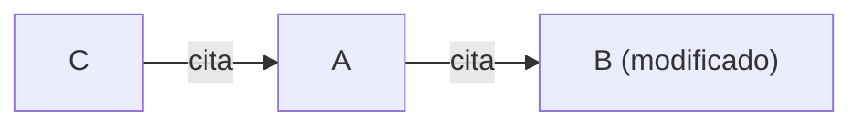
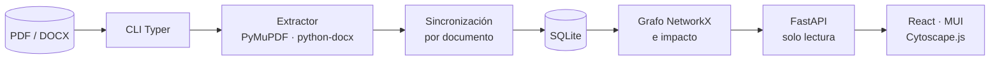

# ISO Trace — Trazabilidad documental ISO

ISO Trace procesa los documentos del sistema de gestión de calidad ISO (PDF, Word y planillas Excel), identifica las referencias que cada documento declara en su sección **REFERENCIAS** y construye un grafo dirigido de relaciones. Con ese grafo responde una pregunta concreta: **si modifico este documento, ¿qué otros documentos podrían necesitar revisión?**

> **Estado: MVP completo (fases 1 a 7 del [plan de implementación](docs/IMPLEMENTATION_PLAN.md)).** Funcionan la CLI (base, extracción, ingesta incremental con log por corrida, grafo único organizado por norma, impacto, exportación, validación y set de referencia), la API REST de consulta y la interfaz web. Queda pendiente anotar el set de referencia sobre los documentos reales para medir precisión y recall (ver [docs/operations.md](docs/operations.md)).

---

## Características (MVP)

- **Ingesta desde la CLI**, completa o incremental (por hash SHA-256), idempotente y transaccional por documento.
- **Extracción solo desde REFERENCIAS**: los códigos que aparecen en otras secciones se ignoran.
- **Subgrupos** como `Procedimientos`, independientes del tipo de documento (un `PR-` puede estar en el grupo general).
- **Evidencia** de cada referencia: página, párrafo, tabla y extracto.
- **Referencias pendientes**: si se cita un documento todavía no incorporado, el código se conserva y se resuelve cuando ese documento se ingesta.
- **Grafo dirigido único** con NetworkX, organizado por norma: referencias salientes y entrantes (también entre normas), dependencias transitivas, ciclos y documentos aislados.
- **Planillas Excel** (`.xlsx`, `.xlsm`, `.xls`) como documentos que se pueden citar (no se analizan sus referencias).
- **Log de cada ingesta**: un archivo por corrida con documentos procesados, referencias, duplicados, incidencias y errores.
- **Análisis de impacto** con profundidad configurable y la ruta que explica por qué aparece cada documento.
- **Exportación** a GraphML, JSON y CSV.
- **Panel de calidad**: secciones ambiguas, códigos inválidos, duplicados, autorreferencias, PDF que requieren OCR, títulos citados inconsistentes y más.
- **Interfaz web de consulta** con búsqueda por norma, detalle, **documento a modificar** (lo que cita y, opcionalmente, quién lo cita, en lista y resaltado sobre el grafo completo), impacto y grafo interactivo.

---

## Conceptos clave

### Dirección de las relaciones

Una arista `A → B` significa **A cita a B**.

| Pregunta | Se responde con |
|---|---|
| ¿Qué documentos usa A? | Referencias **salientes** de A |
| ¿Qué documentos dependen de B? | Referencias **entrantes** de B |
| Si cambia B, ¿qué podría requerir revisión? | **Impacto**: entrantes de B, de forma directa (profundidad 1) o transitiva (profundidad 2 o más) |



Si cambia **B**, el impacto incluye **A** (directo) y **C** (indirecto, ruta `C → A → B`).

> El impacto es un listado de **posibles documentos a revisar**, no la confirmación de que deban modificarse.

### Un solo grafo, organizado por norma

Todos los documentos forman **un único grafo**, porque hay referencias cruzadas entre normas. Cada carpeta de primer nivel del directorio de documentos es una **norma**, que organiza y filtra los documentos:

```text
data/documents/
  ISO 9001/    -> norma "ISO 9001"
  ISO 14001/   -> norma "ISO 14001"
```

- El código es único dentro de cada norma: el mismo código en dos normas son dos documentos distintos.
- Una cita se resuelve primero en la norma de quien cita; si allí no existe, en la única otra norma que tenga ese código. Si lo tienen varias otras normas, la cita queda pendiente y se informa como ambigua (`ambiguous_reference`).
- El impacto y las dependencias cruzan normas.
- Los archivos sueltos en la raíz no pertenecen a ninguna norma: se informan y no se procesan.
- Las planillas (`.xlsx`, `.xlsm`, `.xls`) se identifican por el nombre del archivo y quedan como documentos que se pueden citar.
- Si el mismo archivo está copiado en varias normas, se informa (`duplicate_across_normas`) para mantener las copias sincronizadas.

### Varias ediciones del mismo documento

Si un código aparece en varios archivos de la misma norma, se publica la edición vigente: la de mayor versión, siempre que ninguna versión menor sea más reciente. Las copias idénticas y las ediciones anteriores quedan como avisos informativos. Si versión y fecha no coinciden (por ejemplo, informes anuales cuya versión se reinicia), no se publica ninguna y se registra `ambiguous_editions` para decidir a mano.

### Relación lógica y ocurrencias

Si un documento cita el mismo código dos veces, se guarda **una** relación y **dos** evidencias. Los duplicados no crean aristas múltiples.

### Estados de extracción

| Estado | Significado |
|---|---|
| `ok` | Sección REFERENCIAS encontrada, con códigos |
| `no_references` | Sección encontrada y vacía |
| `no_section` | El documento no tiene sección REFERENCIAS (listados, formularios). Se registra como nodo, sin incidencia |
| `needs_review` | Sección ambigua o límite incierto. Las referencias anteriores se conservan |
| `requires_ocr` | PDF sin texto seleccionable. Las referencias anteriores se conservan |
| `error` | Archivo corrupto, cifrado o ilegible. Las referencias anteriores se conservan |
| `source_code_unresolved` | No se pudo confirmar el código del documento |

Una extracción fallida **nunca** borra referencias vigentes.

---

## Documentos soportados

- **Formatos**: `.pdf` con texto seleccionable y `.docx`. Los PDF escaneados se detectan y se marcan como `requires_ocr` (el MVP no incluye OCR). Cualquier otra extensión se omite.
- **Código del documento**: se toma del nombre de archivo con la convención `CODE-VV Título.ext` (por ejemplo `PO-SGSA-918-02 Política de Gestión de Cambios.pdf`) y se confirma con la portada (`Referencia/Versión : CODE/VV`), el encabezado de página o las propiedades del Word. Si las fuentes se contradicen, no se publica nada y se registra una incidencia.
- **Formato de las referencias**: códigos entre corchetes, como `[ES-SGC-001]`, con el patrón `[A-Z]{2,4}-[A-Z0-9]{2,5}-\d{3,5}`.

Ejemplo de sección:

```text
4 REFERENCIAS
[PO-SGS-400]   Política de Seguridad de la Información
[ES-SGC-001]   Política de la Calidad
Procedimientos
[PR-SGG-000]   Control de Documentos y Registros
[PR-SGG-101]   Procedimiento de Gestión del Personal
5 HISTORIAL
```

---

## Arquitectura



| Área | Tecnología |
|---|---|
| Backend | Python ≥ 3.13, FastAPI, Pydantic v2, SQLAlchemy 2.x, Alembic, Typer |
| Base de datos | SQLite (fuente de verdad; `foreign_keys=ON`, WAL) |
| Procesamiento documental | PyMuPDF (PDF), python-docx (DOCX), expresiones regulares |
| Grafo | NetworkX (`DiGraph`) |
| Frontend | React, TypeScript, Vite, Material UI, Cytoscape.js, TanStack Query |
| Calidad | pytest, Vitest, Ruff |

No se usan LLM, embeddings, RAG, LangChain ni Neo4j.

---

## Estructura del repositorio

```text
iso-trazabilidad/
  backend/
    app/
      api/          # FastAPI (routers, handlers)
      db/           # engine, sesión, pragmas
      ingestion/    # lectores PDF/DOCX, secciones, códigos, extractor
      models/       # modelos SQLAlchemy
      schemas/      # esquemas Pydantic
      services/     # escaneo, sincronización, grafo, impacto, validación
      cli.py        # CLI iso-trace
      config.py     # configuración por entorno
    migrations/     # Alembic
    tests/          # unit, integration, e2e, real
  frontend/
    src/{api,components,pages,graph,types}/
  data/             # documentos e iso.db (fuera de Git)
  docs/             # plan de implementación y documentación técnica
  pyproject.toml
  .env.example
```

---

## Instalación

Requisitos: Python 3.13 o superior con [uv](https://docs.astral.sh/uv/), y Node.js LTS.

```bash
# Backend
uv sync
cp .env.example .env
uv run iso-trace db init

# Frontend
cd frontend
npm ci
```

---

## Configuración

Variables de entorno (archivo `.env`):

| Variable | Por defecto | Descripción |
|---|---|---|
| `ISO_DATABASE_URL` | `sqlite:///data/iso.db` | Base de datos SQLite |
| `ISO_DOCUMENTS_DIR` | `data/documents` | Raíz de documentos; no se procesa nada fuera de ella |
| `ISO_MAX_DEPTH` | `10` | Profundidad máxima de impacto y grafo |
| `ISO_DEFAULT_DEPTH` | `2` | Profundidad por defecto |
| `ISO_GRAPH_MAX_NODES` | `300` | Tope de nodos por subgrafo |
| `ISO_GRAPH_FULL_MAX_NODES` | `3000` | Tope de nodos del grafo completo (vista "Documento a modificar") |
| `ISO_LOG_DIR` | `data/logs` | Carpeta de los logs de ingesta, un archivo por corrida |
| `ISO_LOG_LEVEL` | `INFO` | Nivel mínimo del log de ingesta |
| `ISO_LOG_KEEP` | `200` | Logs de ingesta a conservar; al terminar cada corrida se borran los más viejos (0 = sin límite) |
| `ISO_LOG_MAX_AGE_DAYS` | `0` | Antigüedad máxima de los logs en días (0 = sin límite) |
| `ISO_API_HOST` | `127.0.0.1` | Interfaz donde escucha la API |
| `ISO_CORS_ORIGINS` | `http://localhost:5173` | Orígenes permitidos para el frontend |
| `ISO_EXTRACTION_CONFIG` | — | TOML opcional con alias de encabezados, terminadores y subgrupos |
| `ISO_REAL_SAMPLES_DIR` | — | Documentos reales para las pruebas opcionales |
| `ISO_GOLDEN_SET` | — | CSV local con las referencias esperadas |

---

## Uso de la CLI

```bash
# Inicializar o migrar la base
iso-trace db init

# Ingesta completa del directorio (-v muestra en consola cada evento del log)
iso-trace ingest data/documents

# Solo documentos nuevos o modificados
iso-trace ingest data/documents --incremental

# Reprocesar un documento (siempre forzado); --code fija el código manualmente
iso-trace ingest-file "data/documents/PO-SGSA-918-02 Política de Gestión de Cambios.pdf"

# Ver qué extraería un archivo, sin tocar la base
iso-trace extract "data/documents/MC-SGG-435-23 Manual de los Sistemas de Gestión.pdf" --json

# Validar referencias e incidencias (--strict devuelve código de error si hay problemas)
iso-trace validate --format json

# Totales por norma
iso-trace graph list

# Análisis de impacto (--norma hace falta si el código es documento en más de una norma)
iso-trace impact ES-SGC-001 --depth 3
iso-trace impact MC-SGI-001 --norma "ISO 9001" --format csv --output impacto.csv

# Exportar el grafo completo a un solo archivo
iso-trace graph export --format graphml --output data/export/grafo.graphml

# Otras consultas
iso-trace issues list
iso-trace runs list
iso-trace runs show 12      # totales de la corrida y ruta de su log
iso-trace stats

# Purgar documentos cuyo archivo ya no existe
iso-trace prune --missing

# Set de referencia: borrador para anotar a mano y medición de precisión/recall
iso-trace golden draft samples --output golden/borrador.csv
iso-trace golden evaluate golden/expected.csv --samples samples
```

---

## API REST

```bash
uv run iso-trace api serve        # 127.0.0.1:8000 (ISO_API_HOST / ISO_API_PORT)
```

La documentación interactiva queda en `http://127.0.0.1:8000/docs`.

| Endpoint | Descripción |
|---|---|
| `GET /api/normas` | Normas (carpetas raíz) con sus totales |
| `GET /api/documents?query=` | Búsqueda paginada por código o título, ordenada por norma y nombre (filtros: norma, tipo, sistema, carpeta, estado) |
| `GET /api/documents/{code}` | Detalle del documento |
| `GET /api/documents/{code}/references` | Referencias salientes, entrantes y no resueltas |
| `GET /api/documents/{code}/impact?depth=2` | Impacto directo e indirecto, con rutas |
| `GET /api/documents/{code}/impact.csv?depth=2` | Impacto en CSV |
| `GET /api/documents/{code}/dependencies?depth=2` | Dependencias salientes transitivas |
| `GET /api/graph?code=...&depth=2` | Subgrafo de vecindad para Cytoscape.js |
| `GET /api/graph/full` | Grafo completo (todas las normas) para resaltar lo que cita un documento |
| `GET /api/graph/cycles` | Ciclos detectados |
| `GET /api/references/unresolved` | Referencias a documentos no incorporados |
| `GET /api/quality/issues` | Incidencias de calidad |
| `GET /api/stats` | Estadísticas generales |
| `GET /api/ingestion/runs` | Historial de ingestas |

Los listados se paginan con `page` y `page_size`. Los errores siguen el formato `{"error": {"code", "message", "details"}}`.

---

Las rutas por documento aceptan `norma=`; es obligatorio si el código es documento en más de una norma (409 `norma_required`). Referencia completa: [docs/api.md](docs/api.md).

## Interfaz web

```bash
uv run iso-trace api serve   # en una terminal: API en http://127.0.0.1:8000
cd frontend
npm run dev                  # en otra: http://127.0.0.1:5173, con proxy de /api hacia la API
npm run gen:api              # regenera los tipos TypeScript si cambia la API
```

Cada vista guarda su estado en la URL (`?code=&norma=&depth=…`), así que se puede compartir con un enlace. Si un código es documento en más de una norma, la interfaz pide elegir cuál.

| Pantalla | Qué ofrece |
|---|---|
| **Buscar** | Documentos organizados por norma y nombre; búsqueda por código o título, filtros (norma, tipo, estado) y resultados paginados |
| **Documento a modificar** | Dado un documento: la lista de los documentos que cita (directos y, con más profundidad, indirectos, con su norma) y una pestaña que los muestra resaltados sobre el grafo completo, con cada norma como recuadro y el resto atenuado. El interruptor "Mostrar también quién lo cita" agrega, en lista y en azul sobre el grafo, los posibles documentos a revisar |
| **Detalle** | Metadatos, documentos que cita (marcando los de otra norma), documentos que lo citan, referencias no resueltas o ambiguas y su evidencia |
| **Impacto** | Profundidad ajustable, tabla de posibles documentos a revisar con su ruta y exportación a CSV |
| **Grafo** | Subgrafo interactivo: nodo seleccionado resaltado, flechas hacia el documento citado, no resueltos diferenciados, zoom, filtros por tipo y relación, navegación con doble clic |
| **Calidad** | Totales por norma, incidencias (de la ingesta y calculadas) filtrables por tipo y severidad, referencias pendientes o ambiguas, ciclos e historial de ingestas con sus referencias y log |

La interfaz es de consulta: la ingesta y la actualización se hacen desde la CLI. Las vistas de grafo piden subgrafos; solo "Documento a modificar" carga el grafo completo, acotado por `ISO_GRAPH_FULL_MAX_NODES`.

---

## Pruebas y calidad

```bash
uv run ruff check .
uv run ruff format --check .
uv run pytest

# Opcional: pruebas con documentos reales (no versionados) y set de referencia anotado
ISO_REAL_SAMPLES_DIR=samples ISO_GOLDEN_SET=golden/expected.csv uv run pytest -m real_docs

# Opcional: rendimiento con 500 documentos sintéticos
uv run pytest -m benchmark -s

# Frontend
cd frontend
npm run lint
npm run typecheck
npm run test
npm run build
```

Las pruebas generan sus propios DOCX y PDF sintéticos, así que no hace falta ningún documento real. Incluyen una prueba de extremo a extremo (documentos → CLI → API, con reingesta incremental) y una que falla si `frontend/openapi.json` quedó desactualizado respecto de la API. Las pruebas `real_docs` se saltean si no se configuran `ISO_REAL_SAMPLES_DIR` o `ISO_GOLDEN_SET`.

---

## Confidencialidad

- Los documentos de la organización son **confidenciales**. `samples/`, `data/` y `golden/` están en `.gitignore` y nunca deben subirse al repositorio.
- La API no tiene autenticación en el MVP y escucha solo en `127.0.0.1`. Para exponerla en una red hay que ponerla detrás de un proxy inverso con autenticación.
- La API nunca entrega los archivos originales, solo metadatos y extractos de evidencia.

---

## Documentación

| Documento | Contenido |
|---|---|
| [docs/IMPLEMENTATION_PLAN.md](docs/IMPLEMENTATION_PLAN.md) | Plan técnico completo: arquitectura, modelo de datos, algoritmo de extracción, API, UI, fases y criterios de aceptación |
| [CLAUDE.md](CLAUDE.md) | Reglas del proyecto |
| [.claude/skills/iso-trazabilidad/SKILL.md](.claude/skills/iso-trazabilidad/SKILL.md) | Contrato detallado del extractor |
| [docs/api.md](docs/api.md) | Referencia de la API REST: rutas, parámetros, errores y ejemplos |
| [docs/architecture.md](docs/architecture.md) | Capas, flujo de ingesta, grafo e impacto, decisiones y niveles de prueba |
| [docs/data-model.md](docs/data-model.md) | Tablas, estados de extracción, garantías del esquema y migraciones |
| [docs/operations.md](docs/operations.md) | Instalación, operación diaria, ingesta programada, interpretación de incidencias, set de referencia, copias de seguridad y rendimiento |
