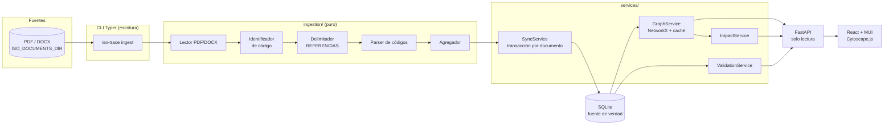
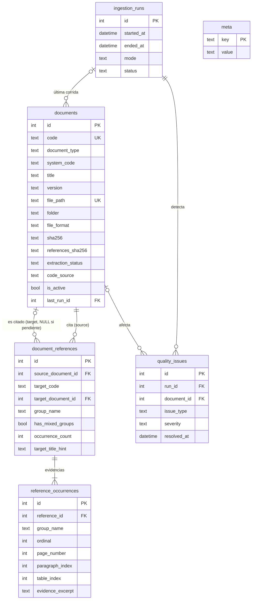
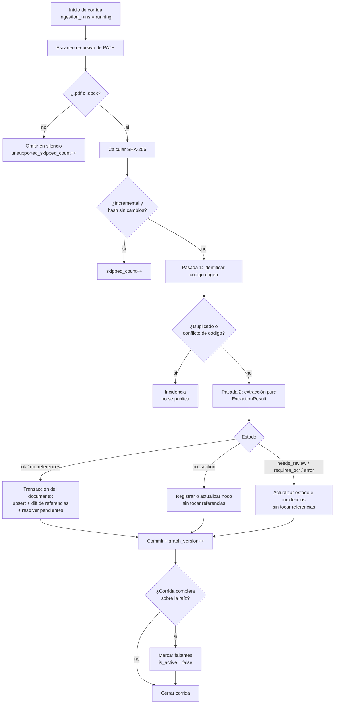
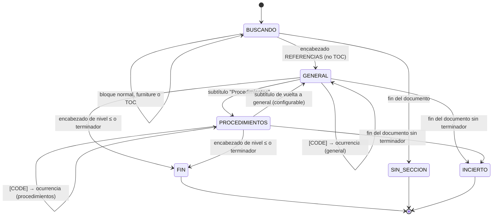
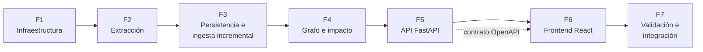

# ISO Trace — Plan de implementación

> Estado: **aprobado para implementación** (2026-10-23). Documento de referencia para todas las fases.
> Fuentes normativas: [`CLAUDE.md`](../CLAUDE.md) y [`.claude/skills/iso-trazabilidad/SKILL.md`](../.claude/skills/iso-trazabilidad/SKILL.md). Ante cualquier conflicto, prevalecen esas fuentes.
>
> **Cambio posterior (2026-10-26, migración `0003`):** el modelo de "un grafo por carpeta raíz" se reemplazó por **un solo grafo** en el que la carpeta raíz es la **norma** (`documents.norma`, código único por norma, referencias e impacto entre normas); se agregaron las planillas XLSX como documentos citables, un log por corrida de ingesta y la vista "Documento a modificar". Donde este plan hable de grafos por carpeta o de `graph_name`, rigen `CLAUDE.md` y [data-model.md](data-model.md).

## Índice

1. [Resumen ejecutivo](#1-resumen-ejecutivo)
2. [Arquitectura propuesta](#2-arquitectura-propuesta)
3. [Estructura del proyecto](#3-estructura-del-proyecto)
4. [Modelo de datos SQLite](#4-modelo-de-datos-sqlite)
5. [Flujo de procesamiento documental](#5-flujo-de-procesamiento-documental)
6. [Algoritmo de extracción de referencias](#6-algoritmo-de-extracción-de-referencias)
7. [Diseño del grafo dirigido](#7-diseño-del-grafo-dirigido)
8. [Diseño de API REST](#8-diseño-de-api-rest)
9. [Propuesta de interfaz React](#9-propuesta-de-interfaz-react)
10. [Plan de implementación por fases](#10-plan-de-implementación-por-fases)
11. [Estrategia de testing](#11-estrategia-de-testing)
12. [Riesgos, decisiones técnicas y supuestos](#12-riesgos-decisiones-técnicas-y-supuestos)
13. [Criterios de aceptación del MVP](#13-criterios-de-aceptación-del-mvp)
14. [Post-MVP](#14-post-mvp)
- [Anexo A — Observaciones sobre los documentos reales](#anexo-a--observaciones-sobre-los-documentos-reales)

---

## 1. Resumen ejecutivo

ISO Trace procesa desde la CLI cientos de documentos de calidad ISO en **PDF** y **DOCX**. Extrae **solo** los códigos entre corchetes que aparecen dentro de la sección **REFERENCIAS** y los guarda en SQLite, que es la fuente de verdad, como relaciones lógicas únicas `origen → citado` junto con sus ocurrencias (evidencia: página, párrafo, tabla, extracto).

Sobre esos datos, una API FastAPI de solo lectura y una interfaz React permiten consultar:

- las referencias **salientes** (lo que un documento cita) y **entrantes** (quién lo cita);
- subgrafos de vecindad interactivos (Cytoscape.js);
- el **análisis de impacto**: los documentos que *podrían* requerir revisión cuando cambia uno, es decir, sus predecesores transitivos en el grafo, con profundidad y ruta explicativa.

La ingesta es **incremental por SHA-256**, **idempotente** y **transaccional por documento**. Es conservadora: ante una sección ambigua, un PDF que requiere OCR, un código de origen dudoso o un error de lectura, **no toca** las referencias vigentes y registra una incidencia. Los documentos sin sección REFERENCIAS (listados, formularios) se registran como nodos sin generar incidencias, para que las citas hacia ellos se resuelvan.

No se usan LLM, embeddings, RAG, LangChain ni Neo4j.

---

## 2. Arquitectura propuesta

Monolito modular en Python más una SPA React. Las capas tienen responsabilidades separadas:

| Capa | Responsabilidad | Depende de |
|---|---|---|
| `ingestion/` | Lectura PDF/DOCX y extracción **pura** (`path → ExtractionResult`), sin base de datos | — |
| `services/` | Escaneo, sincronización, grafo, impacto, validación, consultas | `db/`, `models/`, `ingestion/` |
| `cli.py` | Escritura: ingesta, validación, exportación (Typer) | `services/` |
| `api/` | Consulta de solo lectura (FastAPI) | `services/`, `schemas/` |
| `frontend/` | UI de consulta (React + MUI + Cytoscape.js) | API REST |



Decisiones de arquitectura:

- **Extractor puro**: toda la lógica de lectura y extracción se prueba sin base de datos.
- **SQLite** con `PRAGMA foreign_keys=ON`, `journal_mode=WAL`, `busy_timeout=5000` y `synchronous=NORMAL`, aplicados en un listener `connect` de SQLAlchemy.
- **Grafo efímero**: NetworkX se construye bajo demanda desde SQLite y se guarda en caché según `graph_version`, un contador de la tabla `meta` que se incrementa en cada commit de ingesta.
- **API de solo lectura**: nunca sirve el archivo original, solo metadatos y extractos de evidencia.
- **Configuración** con `pydantic-settings`, por variables de entorno:

| Variable | Valor por defecto | Uso |
|---|---|---|
| `ISO_DATABASE_URL` | `sqlite:///data/iso.db` | Base de datos |
| `ISO_DOCUMENTS_DIR` | `data/documents` | Raíz permitida de documentos |
| `ISO_MAX_DEPTH` | `10` | Profundidad máxima de impacto y grafo |
| `ISO_DEFAULT_DEPTH` | `2` | Profundidad por defecto |
| `ISO_GRAPH_MAX_NODES` | `300` | Tope de nodos por subgrafo |
| `ISO_API_HOST` | `127.0.0.1` | Interfaz donde escucha la API |
| `ISO_CORS_ORIGINS` | `http://localhost:5173` | Orígenes permitidos |
| `ISO_EXTRACTION_CONFIG` | — | TOML opcional con alias de encabezados, terminadores y subgrupos |
| `ISO_REAL_SAMPLES_DIR` | — | Documentos reales para `pytest -m real_docs` |
| `ISO_GOLDEN_SET` | — | CSV local de referencias esperadas |

- **Seguridad**: el MVP no tiene autenticación y los metadatos y extractos son confidenciales. Por eso la API escucha solo en `127.0.0.1`; exponerla en red exige un proxy inverso con autenticación (se documenta en `docs/operations.md`). `samples/`, `data/` y `golden/` están en `.gitignore`. Las rutas se resuelven y se exige `path.resolve().is_relative_to(ISO_DOCUMENTS_DIR)`.

---

## 3. Estructura del proyecto

```text
iso-trazabilidad/
  CLAUDE.md
  README.md
  pyproject.toml            # uv + hatchling; packages=["backend/app"]; script iso-trace = "app.cli:app"
  alembic.ini               # script_location = backend/migrations
  .env.example
  .gitignore                # samples/, data/, golden/, *.db, .venv, node_modules
  .claude/skills/iso-trazabilidad/SKILL.md
  backend/
    app/
      config.py             # Settings (pydantic-settings)
      cli.py                # Typer: db, ingest, ingest-file, extract, validate, impact, graph, prune, issues, runs, stats
      db/
        session.py          # engine, pragmas, session_scope()
        meta.py             # graph_version (la versión del esquema la guarda Alembic en alembic_version)
      models/               # SQLAlchemy 2.x (Mapped[])
        document.py  reference.py  issue.py  ingestion.py
      schemas/              # Pydantic v2
        common.py           # Page[T], ErrorResponse
        document.py  reference.py  impact.py  graph.py  quality.py  stats.py
      ingestion/
        types.py            # TextBlock, ExtractionResult, ReferenceHit, Issue (dataclasses frozen)
        normalize.py        # NFKC, guiones, espacios, clave de encabezado
        readers/
          pdf.py            # PyMuPDF → TextBlock[] (líneas visuales, página, bbox, fuente, negrita, marcadores)
          docx.py           # python-docx → TextBlock[] en orden documental (párrafos y celdas)
        furniture.py        # encabezados/pies repetidos y texto rotado (PDF)
        ocr_detect.py       # heurística requires_ocr
        identify.py         # código, versión y título del documento origen
        sections.py         # encabezados, exclusión de TOC, inicio/fin de REFERENCIAS, subgrupos
        codes.py            # REFERENCE_PATTERN, candidatos inválidos, document_type/system_code
        extractor.py        # orquesta: read → identify → section → codes → aggregate
      services/
        scanner.py          # recorrido, filtro de extensiones, sha256, sanitización de rutas
        sync.py             # reconciliación transaccional por documento, resolución de pendientes
        ingest.py           # corrida (ingestion_runs), duplicados, movidos, faltantes, lock
        graph.py            # DiGraph, subgrafo, ciclos, aislados, exportación
        impact.py           # BFS inverso con profundidad y ruta; impact_to_csv()
        validation.py       # incidencias derivadas
        queries.py          # búsqueda y paginación
      api/
        main.py             # app, CORS, handlers de error
        deps.py             # sesión, settings
        routes/             # documents.py, graph.py, quality.py, stats.py, runs.py
    migrations/
      env.py                # render_as_batch=True
      versions/0001_initial.py
    tests/
      conftest.py           # DB temporal, override de settings, TestClient
      fixtures/builders.py  # genera DOCX/PDF sintéticos en tmp_path (nada binario en Git)
      unit/                 # normalize, codes, sections, identify, readers, extractor, graph, impact
      integration/          # sync, ingest CLI, incremental, API
      e2e/test_flow.py
      real/                 # @pytest.mark.real_docs (skip por defecto)
        test_real_samples.py
        test_golden_set.py
  frontend/
    package.json  vite.config.ts (proxy /api)  tsconfig.json
    src/
      api/        client.ts, hooks.ts (TanStack Query), schema.d.ts (openapi-typescript)
      types/      domain.ts
      components/ AppLayout, DocumentSearchBox, DocumentTable, ReferenceList, ImpactTable,
                  DependencyPath, GraphView, GraphFilters, GraphLegend, IssueTable,
                  PotentialImpactNotice, StatusChip
      pages/      SearchPage, DocumentPage, ImpactPage, GraphPage, QualityPage
      graph/      toElements.ts, styles.ts
      test/       setup.ts, handlers.ts (MSW)
  data/                     # ignorado: documents/, iso.db
  docs/
    IMPLEMENTATION_PLAN.md  architecture.md  data-model.md  api.md  operations.md
```

`main.py` (generado por `uv init`) se elimina en la Fase 1. Se mantiene `requires-python = ">=3.13"`, que cumple el requisito de 3.12 o superior.

---

## 4. Modelo de datos SQLite



### 4.1 Tablas

**`documents`**

| Campo | Tipo | Notas |
|---|---|---|
| `id` | INTEGER PK | |
| `graph_name` | TEXT NOT NULL | Grafo al que pertenece: la primera carpeta de la ruta relativa (cada carpeta raíz es un grafo independiente) |
| `code` | TEXT NOT NULL | Código estable, nunca inferido de una referencia saliente. **Único por grafo**: `UNIQUE (graph_name, code)` |
| `document_type` | TEXT NOT NULL | Prefijo: MC, PO, PR, ES, AL, PC, LC, FC, RG, AC, IN, AX… |
| `system_code` | TEXT NOT NULL | Segundo segmento: SGG, SGS, SGC, SGSA, AFP, INF… |
| `title` | TEXT | |
| `version` | TEXT NULL | Versión ISO (`23`, `01`) |
| `file_path` | TEXT NOT NULL UNIQUE | Relativa a `ISO_DOCUMENTS_DIR`, separador `/` |
| `folder` | TEXT | Carpeta relativa (p. ej. `08 - Operación/8.2 - Procedimientos`) |
| `file_format` | TEXT NOT NULL | `CHECK (file_format IN ('pdf','docx'))` |
| `file_size`, `file_mtime` | INTEGER, DATETIME | |
| `sha256` | TEXT NOT NULL | Último hash leído |
| `references_sha256` | TEXT NULL | Hash que produjo las referencias vigentes; si difiere de `sha256`, las referencias están desactualizadas |
| `extraction_status` | TEXT NOT NULL | Ver [§4.2](#42-estados-de-extracción) |
| `code_source` | TEXT | `filename`, `content`, `filename+content`, `override` |
| `is_active` | BOOLEAN NOT NULL DEFAULT 1 | `false` si el archivo desapareció |
| `metadata_json` | TEXT | Tipo de documento, clasificación, autores, páginas, metadatos PDF/DOCX |
| `last_run_id` | INTEGER FK → `ingestion_runs` | |
| `first_seen_at`, `last_processed_at`, `updated_at` | DATETIME | |

Índices: `code` (único), `document_type`, `system_code`, `title`. La búsqueda usa `LIKE` sin distinguir mayúsculas, suficiente para cientos de documentos.

**`document_references`** (relación lógica única)

| Campo | Tipo | Notas |
|---|---|---|
| `id` | INTEGER PK | |
| `source_document_id` | INTEGER NOT NULL FK → `documents` ON DELETE CASCADE | |
| `target_code` | TEXT NOT NULL | `CHECK (target_code = upper(target_code))` |
| `target_document_id` | INTEGER NULL FK → `documents` ON DELETE SET NULL | `NULL` mientras el destino no esté incorporado |
| `group_name` | TEXT NOT NULL | Grupo predominante (`general`, `procedimientos`) |
| `has_mixed_groups` | BOOLEAN NOT NULL | El código apareció en más de un grupo |
| `occurrence_count` | INTEGER NOT NULL | |
| `target_title_hint` | TEXT NULL | Título leído junto al código |
| `created_at`, `updated_at` | DATETIME | |

Restricción: `UNIQUE (source_document_id, target_code)`. Índices: `source_document_id`, `target_code`, `target_document_id`.

**`reference_occurrences`** (evidencia)

| Campo | Tipo | Notas |
|---|---|---|
| `id` | INTEGER PK | |
| `reference_id` | INTEGER NOT NULL FK → `document_references` ON DELETE CASCADE | |
| `group_name` | TEXT NOT NULL | Grupo de esta ocurrencia |
| `ordinal` | INTEGER NOT NULL | Orden dentro de la sección |
| `page_number`, `paragraph_index`, `table_index`, `row_index`, `cell_index` | INTEGER NULL | Ubicación |
| `raw_text` | TEXT | Token tal como se leyó |
| `evidence_excerpt` | TEXT NULL | Línea completa, hasta 300 caracteres |

**`ingestion_runs`**

`id`, `started_at`, `ended_at`, `mode` (`full`, `incremental`, `single`), `root_path`, `status` (`running`, `completed`, `completed_with_errors`, `failed`, `interrupted`), contadores (`processed_count`, `skipped_count`, `error_count`, `warning_count`, `new_count`, `updated_count`, `missing_count`, `no_section_count`, `unsupported_skipped_count`) y `options_json`.

**`quality_issues`** (incidencias detectadas durante la ingesta)

`id`, `run_id` FK, `document_id` FK NULL (ON DELETE SET NULL), `file_path`, `code` NULL, `issue_type`, `severity` (`info`, `warning`, `error`), `message`, `details_json`, `created_at`, `resolved_at` NULL. Índices: `(issue_type, resolved_at)` y `document_id`. Al reprocesar un documento se cierran sus incidencias abiertas anteriores (`resolved_at`).

**`meta`**: `key` PK, `value`. Guarda `graph_version` (sembrado en `0` por la migración inicial). La versión del esquema la registra Alembic en `alembic_version`.

El historial del MVP se cubre con `ingestion_runs`, `documents.last_run_id` y las incidencias por corrida. Una tabla `document_revisions` queda para después del MVP ([§14](#14-post-mvp)).

### 4.2 Estados de extracción

| Estado | Significado | ¿Reemplaza referencias? |
|---|---|---|
| `ok` | Sección encontrada y delimitada, con códigos | Sí |
| `no_references` | Sección encontrada y delimitada, **vacía** | Sí (deja el conjunto vacío) |
| `no_section` | El documento no tiene sección REFERENCIAS (listados, formularios). Se registra como nodo **sin incidencia** | No |
| `needs_review` | Sección ambigua o fin incierto | No |
| `requires_ocr` | PDF sin texto utilizable | No |
| `error` | Archivo corrupto, cifrado o fallo de lectura | No |
| `source_code_unresolved` | No se pudo confirmar el código del documento | No |

### 4.3 Tipos de incidencia

**Almacenadas** (`quality_issues`): `section_lost`, `section_ambiguous`, `section_end_uncertain`, `requires_ocr`, `invalid_reference_candidate`, `unbracketed_code`, `self_reference`, `duplicate_in_section`, `mixed_groups`, `alternate_format`, `source_code_missing`, `source_code_conflict`, `version_mismatch`, `read_error`, `encrypted`, `sync_error`, `reading_order_ambiguous`, `unknown_subheading`, `bookmark_mismatch`, `textbox_content`, `file_missing`, `file_moved`, `source_code_changed` (la misma ruta declara otro código: no se publica sin `--replace`), `unbracketed_reference` (info: código aceptado sin corchetes dentro de REFERENCIAS), `superseded_version`, `duplicate_copy`, `ambiguous_editions` (las tres de §5.1).

`section_lost` aparece cuando un documento que tenía referencias publicadas deja de tener sección REFERENCIAS. Las referencias se conservan y se avisa, porque probablemente se trate de un error de edición o de lectura.

**Derivadas** (calculadas por `validation.py`, no se guardan):

| Tipo | Regla |
|---|---|
| `unresolved_reference` | `target_document_id IS NULL` |
| `cycle` | Componente fuertemente conexo de tamaño mayor a 1 |
| `isolated_document` | Documento activo sin aristas |
| `hash_drift` | El archivo en disco tiene un hash distinto al registrado |
| `reference_to_inactive` | El destino tiene `is_active = false` |
| `cited_title_mismatch` | `target_title_hint` normalizado frente al `title` real del destino con `difflib.SequenceMatcher` menor a 0,8, ignorando prefijos como "(Procedimiento de)". Señala una posible referencia desactualizada |
| `inconsistent_cited_titles` | Dos orígenes citan el mismo código con títulos distintos. Sirve aunque el destino no esté incorporado |
| `unresolved_similar_code` | Un destino no resuelto cuyo par sistema-número coincide con un documento existente de otro prefijo (p. ej. `RG-SGSA-928` frente a `LC-SGSA-928`). Es solo una sugerencia: nunca se corrige automáticamente |

`GET /api/quality/issues` devuelve ambas fuentes unificadas.

### 4.4 Migraciones

- Alembic con `render_as_batch=True` para poder hacer ALTER en SQLite.
- Migración inicial `0001_initial` escrita a mano y revisada (no solo autogenerada).
- `iso-trace db init` ejecuta `alembic upgrade head` de forma programática e inicializa `meta`.
- Un test verifica `upgrade head → downgrade base → upgrade head` y que el modelo ORM coincida con el esquema migrado (`alembic.autogenerate.compare_metadata`).

---

## 5. Flujo de procesamiento documental



1. **Escaneo**: recorrido recursivo de `PATH` en orden determinista. Solo se consideran `*.pdf` y `*.docx` (sin distinguir mayúsculas). Se ignoran los temporales `~$*` y los ocultos. Cualquier otra extensión (`.dotx`, `.xlsx`, `.pptx`, `.zip`…) se omite en silencio y solo suma a `unsupported_skipped_count`.
2. **Hash**: SHA-256 en streaming. En modo incremental se saltea el archivo si ya existe un documento con la misma `file_path` y el mismo `sha256`. Con `--retry-failed` se reintentan los que quedaron en `error` o `needs_review`.
3. **Identificación** (pasada 1, sobre todos los archivos a procesar): permite detectar duplicados del conjunto antes de publicar nada.
4. **Extracción pura**: devuelve un `ExtractionResult` ([§6](#6-algoritmo-de-extracción-de-referencias)).
5. **Decisión de publicación**:
   - `ok` o `no_references` con código confirmado: se reemplazan las referencias.
   - `no_section`: se registra o actualiza el nodo (código, título, versión, hash) sin tocar referencias. Si el documento tenía referencias publicadas, se conservan y se emite `section_lost`.
   - Cualquier otro estado: se actualizan `sha256`, estado e incidencias **sin tocar** referencias. `references_sha256` conserva su valor anterior, y la UI muestra "referencias desactualizadas".
6. **Transacción por documento** (`with session.begin()`): upsert del documento; diff de referencias (borrar las que salieron, insertar o actualizar las nuevas, reemplazar ocurrencias); resolver pendientes con `UPDATE document_references SET target_document_id = :id WHERE target_code = :code AND target_document_id IS NULL`; resolver los destinos salientes; actualizar `last_run_id`; cerrar incidencias previas; incrementar `graph_version`. Ante cualquier excepción se hace rollback completo, y la incidencia `sync_error` se graba en una transacción aparte.
7. **Cierre de corrida**: los documentos faltantes solo se marcan en una ingesta completa sobre la raíz configurada ([§5.1](#51-casos-especiales)).

### 5.1 Casos especiales

**Un grafo por carpeta raíz** (decisión del 2026-10-23). Cada carpeta de primer nivel dentro de `ISO_DOCUMENTS_DIR` es un grafo de trazabilidad independiente con su nombre (por ejemplo `samples/SGSA ISO 20000` → grafo `SGSA ISO 20000`):
- El código es único **dentro** de cada grafo: la misma copia en A y en B son dos documentos distintos.
- Las referencias se resuelven solo dentro del grafo: si A cita un código que solo existe en B, queda pendiente en A. El impacto nunca cruza de un grafo a otro.
- Los archivos sueltos en la raíz no pertenecen a ningún grafo: se informan (contador `root_files_count`) y no se procesan.
- Mover un archivo a otra carpeta raíz crea el documento en el grafo nuevo y deja inactivo el del grafo anterior.

**Identificación del código origen.** Candidatos, en orden:

1. **Nombre de archivo** con la convención `CODE-VV Título.ext`: `^([A-Z]{2,4}-[A-Z0-9]{2,5}-\d{3,5})(?:-(\d{2}))?\s`. Sufijos como `v2` se ignoran.
2. **Portada**: campo `Referencia/Versión : CODE/VV` (aparece tanto en la plantilla Word como en los exportados desde Excel) o encabezado de página `CODE / VV - Título - Página N/M`.
3. **DOCX**: `docProps/custom.xml` (propiedad `Referencia`, versión, tipo) y `core_properties.title`.
4. **Metadatos PDF** (`title`, `subject`), si aportan algo.

| Situación | Resultado |
|---|---|
| Nombre válido y contenido coincidente | `code_source = filename+content` |
| Nombre válido, sin código en el contenido | `code_source = filename` |
| El contenido contradice el nombre | `source_code_conflict`, no se publica |
| Nombre sin código; portada y encabezado coinciden | `code_source = content` |
| Nombre sin código y contenido ambiguo | `source_code_missing`, no se publica |
| Override manual | `iso-trace ingest-file PATH --code X` → `code_source = override` |
| Versión del nombre distinta de la portada | `version_mismatch` (warning) |

Título: línea `CODE - Título` de la portada o fila `Nombre`; si no, `core_properties.title`; si no, el nombre de archivo sin código ni versión.

**Varias ediciones del mismo código en un grafo** (decisión del 2026-10-23, `services/editions.py`):
- Copias idénticas (mismo SHA-256): `duplicate_copy` (info); se publica una sola.
- Vigente: la de **mayor versión**, siempre que ninguna versión menor tenga una fecha de modificación más reciente. A igual versión, gana el formato preferido (`alternate_format`, info). Las demás: `superseded_version` (info).
- Si versión y fecha no coinciden (caso real: informes periódicos ES-SGS-525 / ES-SGS-404 cuya versión se reinicia cada año), **no se publica ninguna**: `ambiguous_editions` (error) con la lista de ediciones. Si el documento ya estaba publicado, se mantiene. Se resuelve dejando solo la vigente o con `ingest-file --replace`.
- Se aplica igual dentro de una corrida y frente a lo ya registrado.


**Archivo eliminado.** `is_active = false` e incidencia `file_missing`. Sus referencias salientes se conservan pero quedan fuera del grafo activo; las entrantes pasan a `target_document_id = NULL` (vuelven a estar pendientes). La purga es explícita con `iso-trace prune --missing` (borrado real en cascada). Nunca se marcan faltantes con `ingest-file` ni con un `PATH` distinto de la raíz.

**Archivo movido o renombrado.** Si un archivo nuevo tiene el mismo código que un documento cuyo `file_path` ya no existe, se actualiza la ruta, se reprocesa y se emite `file_moved` (info). Así se evitan falsos `duplicate_code`.

**Concurrencia.** Una sola corrida de escritura a la vez: se rechaza si hay una corrida `running` reciente. `--force-unlock` marca como `interrupted` una corrida colgada.

---

## 6. Algoritmo de extracción de referencias



### 6.1 Lectura a `TextBlock`

Cada bloque contiene: `text` (normalizado), `raw_text`, `page`, `kind` (`line`, `paragraph`, `cell`), `paragraph_index`, `table_index`, `row`, `col`, `style`, `heading_level_hint`, `is_bold`, `font_size` y `bbox`.

**PDF (PyMuPDF)**

- `page.get_text("dict")`, página por página y en orden.
- Las líneas visuales se reconstruyen agrupando spans por línea base (tolerancia de unos 2 pt) y ordenando por `x`, para que `[CODE]   Título` quede en una sola línea.
- Se descarta el texto rotado (`line["dir"] != (1, 0)`), como el "CONFIDENCIAL TILSOR" vertical.
- `furniture.py` marca como encabezado o pie las líneas ubicadas en el 10 % superior o inferior de la página cuyo texto normalizado (dígitos reemplazados por `#`) se repite en al menos el 50 % de las páginas.
- Si dentro de la sección hay bloques con columnas solapadas, se emite `reading_order_ambiguous`.
- No se depende del nombre de la fuente, porque varía entre documentos.

**DOCX (python-docx)**

- Se recorre `document.element.body` en orden (`w:p` y `w:tbl`), con las celdas fila por fila y sin repetir celdas combinadas. Párrafos y tablas quedan intercalados en su orden real.
- `paragraph.text` ya une los runs (encabezados partidos) e ignora los códigos de campo (`instrText`).
- El nivel de encabezado se toma del **nombre interno** del estilo (`heading N`; python-docx lo expone como `Heading N` aunque el ID esté localizado, como `Ttulo1`) o de `w:outlineLvl` resuelto por la cadena `basedOn`. Nunca del ID del estilo.
- La numeración vive en el estilo: el texto dice `HISTORIAL`, no `1 HISTORIAL`. Por eso el nivel no puede depender del número escrito.
- Tabla de contenido: los estilos `toc N` (ID localizado `TDC1`…) se excluyen.
- Cuadros de texto (`w:txbxContent`): se lee solo `mc:Choice` para no duplicar el texto. Si alguno contiene "REFERENCIAS", se emite `textbox_content`.
- Los encabezados y pies de Word están en otras partes del paquete y se ignoran.

**Normalización (`normalize.py`)**

- Unicode NFKC.
- Guiones `‐ ‑ ‒ – — − ﹣ －` → `-`.
- NBSP y espacios repetidos → un espacio.
- Se conserva siempre `raw_text` para auditoría.
- Clave de encabezado: casefold, sin tildes, sin numeración y sin puntuación final (`"4  Referencias:"` → `referencias`).

### 6.2 Detección de OCR

- Una página se considera "sin texto" si tiene menos de 25 caracteres útiles (sin contar encabezados y pies) **y** contiene imágenes que cubren la mayor parte de la página. Una página en blanco intencional no cuenta.
- El documento queda en `requires_ocr` si al menos el 80 % de sus páginas son "sin texto" o si no tiene texto en absoluto.
- Si la sección no aparece y hay páginas escaneadas parciales, se emite `requires_ocr` como warning.
- PDF cifrado → `error` con incidencia `encrypted`.

### 6.3 Clasificación de encabezados

Un bloque que no es encabezado ni pie de página se considera encabezado si cumple al menos una condición:

1. Tiene estilo u outline de encabezado en DOCX.
2. Coincide con `^(\d+(?:\.\d+)*)\.?\s+(.{2,80})$` y el texto está mayormente en mayúsculas, o en negrita, o con un tamaño de fuente mayor o igual al del cuerpo. El nivel es la cantidad de componentes numéricos (`4` → 1, `7.2.1` → 3).
3. Es una línea corta (6 palabras o menos), sin corchetes ni nada con forma de código, en negrita o en MAYÚSCULAS, y aislada. El tamaño de fuente **no** cuenta para esta regla: en documentos cortos el encabezado y el pie de página pesan más que el cuerpo y distorsionan el tamaño de referencia.

**Exclusión de la tabla de contenido**: líneas con puntos de relleno (`\.{3,}\s*\d+$`) o tabulación y número de página (`\t\d+$`), estilos `toc N`, o regiones que empiezan con "Tabla de contenido", "Índice" o "Contenido".

**Marcadores PDF (señal adicional).** Si `doc.get_toc()` devuelve marcadores, se busca el de clave `referencias` y el siguiente de nivel igual o superior, que dan las páginas esperadas de inicio y fin. Esto **confirma**, pero no reemplaza, la detección por encabezados:

- Si coinciden, aumenta la certeza (por ejemplo, permite aceptar un fin que de otro modo quedaría como `section_end_uncertain`).
- Si discrepan, se emite `bookmark_mismatch` y se aplica el criterio más conservador (`needs_review` si la detección por encabezados no es concluyente).
- Si no hay marcadores, se usa solo la detección por encabezados.

### 6.4 Inicio de la sección

Es el encabezado, fuera de la tabla de contenido, cuya clave pertenece a los alias configurables (`referencias`; a validar `documentos de referencia` y `referencias normativas`). Una mención en prosa ("ver referencias") no es encabezado.

| Candidatos | Resultado |
|---|---|
| 0 | `no_section`: se registra el nodo sin referencias extraídas y sin incidencia. Si el documento tenía referencias, se conservan y se emite `section_lost` |
| 1 | Inicio de la sección |
| Más de 1 | Se elige el único seguido de al menos un código entre corchetes antes del siguiente encabezado. Si sigue siendo ambiguo: `section_ambiguous` → `needs_review` |

`no_section` no equivale a "sin referencias": solo `no_references` (sección encontrada y vacía) declara que un documento no cita nada. Una aparición de "REFERENCIAS" únicamente en la tabla de contenido se trata como `no_section`.

### 6.5 Fin de la sección

La sección termina en el primer encabezado posterior que cumpla alguna de estas condiciones:

- tiene un nivel igual o superior al de REFERENCIAS (por ejemplo, `5 HISTORIAL` tras `4 REFERENCIAS`);
- su clave pertenece a la lista configurable de terminadores: `historial`, `control de cambios`, `definiciones`, `descripcion`, `anexos`, `aprobaciones`, `registros`, `desarrollo`…

Reglas adicionales:

- Los **subgrupos** conocidos **no** terminan la sección: `procedimientos` cambia el grupo a `procedimientos` (mapa configurable). Se reconocen por su texto aunque no tengan formato de encabezado (por ejemplo, una celda de tabla sin negrita). Al entrar a REFERENCIAS el grupo es `general`.
- Un encabezado corto desconocido, sin número, dentro de la sección mantiene el grupo actual y emite `unknown_subheading`.
- Si se llega al final del documento sin terminador, el resultado es `section_end_uncertain` → `needs_review`, salvo que después del último código solo haya líneas de código y título (configurable) o que los marcadores PDF confirmen el fin.
- El salto de página no corta la sección: los encabezados y pies ya se filtraron.

### 6.6 Identificación de códigos

Solo dentro de la sección delimitada:

```python
REFERENCE_PATTERN = re.compile(
    r"\[\s*([A-Z]{2,4}-[A-Z0-9]{2,5}-\d{3,5})\s*\]",
    re.IGNORECASE,
)
CANDIDATE_PATTERN = re.compile(
    r"\[?\s*[A-Z]{1,5}\s*[-_ ]\s*[A-Z0-9]{2,6}\s*[-_ ]\s*\d{2,6}\s*\]?",
    re.IGNORECASE,
)
```

- **Estricto**: el código se pasa a mayúsculas; el texto que queda en la línea se guarda como `target_title_hint`.
- **Candidato** que no coincide con el patrón estricto: `invalid_reference_candidate`, sin normalizar ni crear relación.
- **Código válido sin corchetes al inicio de la línea o solo en una celda** (dentro de la sección): se acepta como referencia e incidencia `unbracketed_reference` (info). Caso real: tabla `ES-SGG-003 | Especificaciones de implementación CRM` en IN-SGC-001; el título se toma de la celda siguiente de la misma fila.
- **Código válido sin corchetes en otra posición** (a mitad de línea): `unbracketed_code` (warning), sin relación.
- `document_type` es el prefijo (antes del primer `-`) y `system_code` el segundo segmento. Ambos son independientes del grupo de aparición: un `PR-` puede estar en el grupo `general`.

### 6.7 Agregación

- `dict[target_code] → [ocurrencias]`.
- Grupo predominante: el más frecuente; ante empate, el de la primera aparición. `has_mixed_groups` si el código apareció en más de un grupo.
- Duplicados dentro de la sección: una relación y N evidencias, con incidencia `duplicate_in_section` (info).
- `target_code == source_code`: incidencia `self_reference` y **no** se crea arista.
- Sección encontrada y delimitada sin códigos: `no_references`.

### 6.8 Resultado

```text
ExtractionResult(
    source_code, source_code_origin, version, title, status,
    references=[ReferenceHit(code, group, has_mixed_groups, title_hint, occurrences=[...])],
    issues=[Issue(type, severity, message, details)],
    stats={pages, ocr_pages, section_span},
)
```

El comando de diagnóstico `iso-trace extract PATH --json` ejecuta la extracción sin base de datos, para evaluar documentos reales.

### 6.9 Caso de aceptación (SKILL)

Texto dentro de REFERENCIAS seguido de la subsección `Procedimientos` (ver SKILL.md):

- 36 apariciones totales y 35 códigos únicos;
- 27 códigos en el grupo `general` y 8 códigos únicos en `procedimientos`;
- `PR-SGG-101` aparece 2 veces: 1 relación lógica y 2 evidencias;
- ninguna relación extraída de las secciones anteriores ni posteriores.

### 6.10 Resultados esperados sobre los documentos reales

Se verifican con `pytest -m real_docs` (requiere `ISO_REAL_SAMPLES_DIR`; los documentos nunca se suben a Git).

| Documento | Esperado |
|---|---|
| MC-SGG-435 | Sección en págs. 4–5; 36 ocurrencias, 35 relaciones, 27 `general`, 8 `procedimientos`, `PR-SGG-101` ×2; nada desde §3 (tabla de perfiles), §6, §7.2.2 ni HISTORIAL |
| AL-SGSA-911 | 3 relaciones (ES-SGSA-919, AC-SGSA-920, ES-SGG-597); las menciones en §6 y §7 se ignoran |
| PO-SGSA-918 | 4 relaciones (ES-SGG-597, PR-AFP-200, IN-AFP-203, PC-SGSA-914) |
| ES-SGSA-919 | 5 relaciones, entre ellas MC-SGG-435 y PC-SGSA-914 |
| PC-SGSA-914 | 45 relaciones (confirmado por la extracción), todas en `general` aunque incluye `PR-`; la sección cruza de la pág. 4 a la 5 |
| LC-SGSA-915/921/922/928 | `no_section`, 0 relaciones, sin incidencia; las citas hacia ellos se resuelven |
| ES-SGSA-923, FC-SGSA-924 | `no_section`; código tomado de la portada `Referencia/Versión` |
| `.dotx`, `.xlsx`, `.pptx` | Omitidos (`unsupported_skipped_count = 9`); la cita a RG-SGSA-927 queda pendiente |
| Corpus completo | Ciclos MC-SGG-435 ↔ PC-SGSA-914 y PC-SGSA-914 ↔ ES-SGSA-919; `inconsistent_cited_titles` para ES-SGC-100; `unresolved_similar_code` RG-SGSA-928 → LC-SGSA-928 |

---

## 7. Diseño del grafo dirigido

- **Un `nx.DiGraph` por grafo** (carpeta raíz), con nombre = la carpeta. Cada nodo es un `code` del grafo, con atributos `title`, `document_type`, `system_code`, `status`, `active` y `resolved`. `resolved = false` identifica un **nodo virtual**: un código citado que todavía no tiene documento. No simula un archivo presente.
- Una arista `A → B` significa **A cita a B**, con atributos `group`, `occurrences` y `mixed_groups`.

| Consulta | Operación | Semántica |
|---|---|---|
| Salientes de A | `successors(A)` | Documentos que A **usa** |
| Entrantes de B | `predecessors(B)` | Documentos que **dependen** de B |
| Dependencias transitivas de A | BFS sobre `successors` hasta `depth` | Contexto de A |
| **Impacto de B** | BFS sobre `predecessors` hasta `depth` | Posibles documentos a revisar si B cambia |

**Algoritmo de impacto**

- BFS inverso desde la raíz con un conjunto `visited`, que protege contra ciclos.
- Para cada afectado se guarda la distancia mínima (1 = directo, mayor a 1 = indirecto) y un padre BFS, de donde sale una ruta explicativa de longitud mínima `X → … → RAÍZ`.
- La raíz nunca aparece en sus propios resultados, aunque exista un ciclo.
- Funciona también sobre nodos virtuales: muestra quién cita un código pendiente.
- El resultado se rotula siempre como "posibles documentos a revisar", nunca como "documentos que deben modificarse".


Si cambia **B**: impacto = {A: profundidad 1 (directo), C: profundidad 2 (indirecto, ruta C → A → B)}. Las dependencias salientes de **C** son {A: 1, B: 2}.

**Otras funciones**

- **Filtros**: `groups` (tipo de relación), `types` (prefijos), `systems`, `include_unresolved`, `include_inactive`.
- **Ciclos**: componentes fuertemente conexos de tamaño mayor a 1, más `nx.simple_cycles(G, length_bound=10)` con un tope de resultados.
- **Aislados**: documentos activos sin aristas.
- **No resueltos**: nodos con `resolved = false`.
- **Subgrafo para la UI**: ego-graph por dirección (`in`, `out`, `both`) y profundidad, truncado a `ISO_GRAPH_MAX_NODES` priorizando los nodos más cercanos (`truncated = true`).
- **Exportación**: GraphML (`nx.write_graphml`, solo atributos escalares) y JSON (`nx.node_link_data`).
- **Caché**: el grafo vive en memoria del proceso de la API y se reconstruye cuando cambia `meta.graph_version`.

---

## 8. Diseño de API REST

**Convenciones**

- Prefijo `/api`. Los códigos se normalizan a mayúsculas.
- Paginación: `Page[T] = {items, total, page, page_size}` con `page ≥ 1` y `page_size` entre 1 y 200 (por defecto 50).
- Errores: `{"error": {"code": "...", "message": "...", "details": {...}}}`.

| HTTP | `error.code` | Cuándo |
|---|---|---|
| 404 | `document_not_found` | El código no existe ni como documento ni como destino citado |
| 400 | `depth_out_of_range` | `depth` mayor que `ISO_MAX_DEPTH` o menor que 1 |
| 422 | `validation_error` | Parámetros inválidos (Pydantic) |
| 500 | `internal_error` | Error genérico, sin trazas en la respuesta |

**Endpoints.** Todas las rutas de documentos, impacto y grafo se acotan a un grafo con el parámetro `graph` (obligatorio si el código existe en más de uno; si existe en uno solo se infiere). Ejemplo: `GET /api/documents/ES-SGC-001/impact?graph=SGSA%20ISO%2020000&depth=2`.

| Método y ruta | Parámetros | Respuesta |
|---|---|---|
| `GET /api/health` | — | `{status, db, graph_version}` |
| `GET /api/graphs` | — | Grafos disponibles: `[{name, documents, references, unresolved}]` |
| `GET /api/documents` | `query`, `type`, `system`, `folder`, `status`, `active`, `page`, `page_size`, `sort` | `Page[DocumentSummary]` |
| `GET /api/documents/{code}` | — | `DocumentDetail`: metadatos, versión, hash, estado, `references_stale`, conteos, incidencias abiertas, última corrida |
| `GET /api/documents/{code}/references` | `group` | `{outgoing[], incoming[], unresolved[]}` con ítems `ReferenceItem{code, title, document_type, resolved, group, has_mixed_groups, title_hint, occurrences[]}` |
| `GET /api/documents/{code}/impact` | `depth`, `groups`, `types` | `ImpactResult{root, disclaimer, depth, direct[], indirect[], summary{by_depth, by_type}}` con ítems `{code, title, document_type, depth, path[]}` |
| `GET /api/documents/{code}/impact.csv` | `depth`, `groups`, `types` | `text/csv` UTF-8 con BOM (se abre directo en Excel). Columnas: código raíz, fecha, profundidad máxima, código, título, tipo, profundidad, directo/indirecto, ruta. Encabezado con la leyenda "posibles documentos a revisar". Usa la misma función de serialización que la CLI |
| `GET /api/documents/{code}/dependencies` | `depth` | Dependencias salientes transitivas (misma forma que el impacto) |
| `GET /api/graph` | `code` (obligatorio), `depth`, `direction`, `types`, `groups`, `include_unresolved`, `max_nodes` | `{root, nodes[], edges[], truncated}` listo para Cytoscape |
| `GET /api/graph/cycles` | `limit` | Lista de ciclos |
| `GET /api/stats` | — | Totales por estado y tipo, referencias, pendientes, ciclos, aislados, última corrida |
| `GET /api/references/unresolved` | `query`, `page`, `page_size` | `Page[{target_code, cited_by_count, cited_by[], title_hint}]` |
| `GET /api/quality/issues` | `type`, `severity`, `code`, `open`, `page`, `page_size` | `Page[QualityIssue]` (almacenadas y derivadas) |
| `GET /api/ingestion/runs` | `page`, `page_size` | `Page[IngestionRun]` |

Ejemplo de respuesta de impacto:

```json
{
  "root": {"code": "ES-SGC-001", "title": "Política de la Calidad", "resolved": true},
  "disclaimer": "Posibles documentos a revisar. No implica necesidad confirmada de modificación.",
  "depth": 2,
  "direct": [
    {"code": "MC-SGG-435", "title": "Manual de los Sistemas de Gestión", "document_type": "MC",
     "depth": 1, "path": ["MC-SGG-435", "ES-SGC-001"]}
  ],
  "indirect": [
    {"code": "PC-SGSA-914", "title": "Plan de Gestión de Servicios", "document_type": "PC",
     "depth": 2, "path": ["PC-SGSA-914", "MC-SGG-435", "ES-SGC-001"]}
  ],
  "summary": {"by_depth": {"1": 1, "2": 1}, "by_type": {"MC": 1, "PC": 1}}
}
```

Todas las respuestas usan modelos Pydantic v2 (`response_model`). El esquema OpenAPI se exporta para generar los tipos TypeScript del frontend.

---

## 9. Propuesta de interfaz React

Stack: React + TypeScript + Vite, MUI, React Router, TanStack Query y Cytoscape.js (layouts `breadthfirst` y `cose` incluidos; `cytoscape-fcose` es opcional). No se agrega un estado global extra.

| Pantalla | Ruta | Contenido |
|---|---|---|
| Layout | — | AppBar con buscador global (Autocomplete por código y título) y navegación: Buscar · Impacto · Grafo · Calidad |
| Búsqueda | `/` | Búsqueda con debounce, filtros por tipo, sistema y estado, tabla paginada en el servidor (código, título, tipo, versión, estado, nº de salientes y entrantes) |
| Detalle | `/documents/:code` | Cabecera con metadatos y `StatusChip` (alerta si las referencias están desactualizadas o en revisión). Pestañas: **Referencias** (listas separadas "Documentos que cita" y "Documentos que lo citan", más "No resueltas"; cada ítem se expande con su evidencia: página, tabla, extracto), **Impacto**, **Grafo**, **Incidencias** |
| Impacto | `/impact?code=&depth=` | Selector de documento, control de profundidad, filtros de grupo y tipo. Aviso fijo `PotentialImpactNotice`: "Posibles documentos a revisar; no implica necesidad confirmada de modificación". Tabla (código, título, tipo, profundidad, directo/indirecto, ruta como chips `X → Y → RAÍZ` con la leyenda "→ = cita a"), resumen por profundidad, referencias salientes como contexto y botón **Exportar CSV** |
| Grafo | `/graph?code=&depth=&direction=` | Siempre un subgrafo, nunca el grafo completo (ver abajo) |
| Calidad | `/quality` | Franja con totales de `/api/stats` y la última corrida; pestañas por tipo de incidencia con conteos; tabla paginada con enlace al documento |

**Grafo interactivo**

- Nodo raíz resaltado (borde grueso, color primario); nodos no resueltos con borde punteado y gris; inactivos atenuados.
- Flechas `target-arrow-shape: triangle` hacia el documento **citado**, respetando `origen → citado`.
- Aristas por grupo: línea sólida para `general`, discontinua para `procedimientos`. Color de nodo por tipo de documento.
- Zoom y desplazamiento nativos, con botones de ajustar y restablecer.
- Un clic abre un panel lateral con el resumen del nodo; doble clic recentra el subgrafo en ese nodo; el botón "Abrir detalle" navega a su página.
- Filtros: tipos, sistemas, grupos, dirección, profundidad, incluir no resueltos. Aviso cuando el subgrafo se truncó. Leyenda permanente.
- La conversión `toElements(graphDto)` y la hoja de estilos viven en `src/graph/` como funciones puras, testeables sin canvas.

---

## 10. Plan de implementación por fases

Antes de cada fase se presentan el plan, los supuestos y los criterios de aceptación (CLAUDE.md). Al cerrar cada fase se ejecutan y reportan `ruff check`, `ruff format --check` y `pytest` (y `npm run lint`, `npm run test`, `npm run build` en el frontend).



La Fase 6 puede empezar en paralelo con la 5 usando MSW, una vez fijados los esquemas.

### Fase 1 — Estructura e infraestructura

| | |
|---|---|
| **Objetivo** | Esqueleto ejecutable y base de datos migrable |
| **Tareas** | `.gitignore` (antes de cualquier commit); reorganizar `pyproject.toml` (dependencias: fastapi, uvicorn, pydantic, pydantic-settings, sqlalchemy, alembic, typer, networkx, pymupdf (<2: la serie 2.x arrastra onnxruntime, un motor de inferencia de ML que el MVP no necesita), python-docx; desarrollo: pytest, pytest-cov, ruff, httpx); Ruff (`E,F,I,B,UP,SIM`, línea 100); pytest con el marcador `real_docs`; eliminar `main.py`; `.env.example`; `config.py`; `db/session.py` con pragmas; modelos ORM; Alembic y migración `0001`; `iso-trace db init`; scaffold Vite + React + TS + MUI + Vitest + oxlint (linter por defecto de la plantilla de Vite) |
| **Archivos** | `pyproject.toml`, `alembic.ini`, `.env.example`, `backend/app/{config,cli}.py`, `backend/app/db/*`, `backend/app/models/*`, `backend/migrations/*`, `frontend/*` |
| **Dependencias** | Ninguna |
| **Pruebas** | Pragmas activos (`foreign_keys = 1`, `journal_mode = wal`); upgrade/downgrade; restricciones (UNIQUE `code`, UNIQUE origen+destino, FK); `db init` idempotente |
| **Aceptación** | `uv run iso-trace db init` crea `data/iso.db` con el esquema; `pytest` y `ruff` en verde; `npm run test` en verde |
| **Riesgos** | Wheels de PyMuPDF en Windows con Python 3.13 (verificar al instalar); WAL en carpetas de red (documentar que la base debe ser local) |

### Fase 2 — Procesamiento documental

| | |
|---|---|
| **Objetivo** | `ExtractionResult` correcto, sin base de datos |
| **Tareas** | `normalize`, `codes`, `readers/pdf` (líneas visuales, encabezados y pies, texto rotado, marcadores), `readers/docx` (orden documental, tablas, estilos por nombre interno, cuadros de texto), `ocr_detect`, `identify`, `sections` (encabezados, tabla de contenido, inicio y fin, subgrupos), `extractor`, configuración TOML de alias; `fixtures/builders.py` que genera DOCX (python-docx, con estilos de encabezado, tablas y numeración en el estilo) y PDF (PyMuPDF, con encabezado y pie repetidos, tabla de contenido con puntos de relleno, salto de página dentro de REFERENCIAS, códigos fuera de la sección y una variante solo imagen); comando `iso-trace extract` |
| **Archivos** | `backend/app/ingestion/*`, `backend/tests/fixtures/builders.py`, `backend/tests/unit/*`, `backend/tests/real/test_real_samples.py` |
| **Dependencias** | Fase 1 |
| **Pruebas** | Casos de extracción de [§11](#11-estrategia-de-testing); réplica sintética del manual real; `real_docs` contra `samples/` |
| **Aceptación** | Caso del SKILL exacto en PDF y DOCX sintéticos (36/35/27/8, `PR-SGG-101` ×2) y en el PDF real; tabla de [§6.10](#610-resultados-esperados-sobre-los-documentos-reales) reproducida; cero relaciones fuera de la sección; PDF escaneado → `requires_ocr`; documento sin sección → `no_section` |
| **Riesgos** | Orden de lectura en tablas y columnas (líneas por línea base + warning); variedad de plantillas (alias configurables y `extract --json` para auditar); DOCX reales no vistos todavía (validar con al menos uno antes de cerrar la fase) |

### Fase 3 — Persistencia e ingesta incremental

| | |
|---|---|
| **Objetivo** | Sincronización confiable, idempotente y transaccional por documento |
| **Tareas** | `scanner` (extensiones, hash, sanitización de rutas), `sync` (diff por documento, resolución de pendientes, incidencias), `ingest` (corridas, dos pasadas, duplicados, formato alternativo, movidos, faltantes, lock); CLI `ingest PATH [--incremental] [--retry-failed] [--dry-run]`, `ingest-file PATH [--code] [--replace]` (siempre forzado), `validate [--strict] [--format table\|json]`, `prune --missing`, `issues list`, `runs list`, `stats` |
| **Archivos** | `backend/app/services/{scanner,sync,ingest,validation}.py`, `backend/app/cli.py`, `backend/tests/integration/*` |
| **Dependencias** | Fases 1 y 2 |
| **Pruebas** | Integración con SQLite temporal: incremental, rollback, duplicados, movido, eliminado, OCR y `no_section` preservan referencias, resolución de pendientes, idempotencia (dos corridas dan el mismo estado y `skipped = N`) |
| **Aceptación** | Una reingesta sin cambios no reprocesa nada; quitar una referencia del archivo elimina solo esa relación; una falla inducida en la persistencia deja la base idéntica; una referencia pendiente se resuelve al ingresar su destino |
| **Riesgos** | Bloqueos de SQLite (un solo escritor y `busy_timeout`); rutas de Windows (guardar rutas relativas con `/`) |

### Fase 4 — Grafo y análisis de impacto

| | |
|---|---|
| **Objetivo** | Consultas de grafo correctas y rápidas |
| **Tareas** | `graph.build_graph(session, filters)` con caché por `graph_version`; `impact.impacted_by(code, depth, filters)`; `dependencies_of`; `subgraph`; `cycles`; `isolated`; exportación GraphML/JSON; `impact_to_csv()` compartido por CLI y API; incidencias derivadas de [§4.3](#43-tipos-de-incidencia); CLI `impact CODE --depth N [--format table\|json\|csv] [--output]` y `graph export --format graphml\|json --output` |
| **Archivos** | `backend/app/services/{graph,impact,validation}.py`, `backend/tests/unit/test_graph.py`, `backend/tests/unit/test_impact.py` |
| **Dependencias** | Fase 3 |
| **Pruebas** | Unitarias sobre grafos armados a mano y desde la base |
| **Aceptación** | Caso 6 del SKILL (A→B, C→A ⇒ impacto de B = A:1, C:2); los ciclos no generan bucles ni incluyen la raíz; el GraphML se reabre con `nx.read_graphml`; el CSV tiene las mismas filas que el JSON |
| **Riesgos** | Grafo desactualizado en la API (versionado con `graph_version`) |

### Fase 5 — Backend FastAPI

| | |
|---|---|
| **Objetivo** | API tipada de solo lectura |
| **Tareas** | Esquemas Pydantic, `queries.py`, routers de [§8](#8-diseño-de-api-rest), handlers de error, dependencias de sesión, CORS, arranque en `127.0.0.1`, exportación de OpenAPI, `docs/api.md` |
| **Archivos** | `backend/app/api/*`, `backend/app/schemas/*`, `backend/app/services/queries.py`, `backend/tests/integration/test_api_*.py` |
| **Dependencias** | Fases 3 y 4 |
| **Pruebas** | `TestClient` sobre una base poblada con fixtures: paginación, búsqueda, 404, 400 por profundidad, forma de `references` e `impact`, CSV, subgrafo truncado, incidencias unificadas |
| **Aceptación** | Todos los endpoints documentados en OpenAPI y testeados; sin SQL crudo con interpolación |
| **Riesgos** | Consultas N+1 (`selectinload`, consultas agregadas) |

### Fase 6 — Frontend React

| | |
|---|---|
| **Objetivo** | UI de consulta de [§9](#9-propuesta-de-interfaz-react) |
| **Tareas** | Cliente de API y tipos generados con `openapi-typescript`; hooks de TanStack Query; layout MUI; páginas y componentes; `toElements` y estilos de Cytoscape; filtros sincronizados con la URL; estados vacío, cargando y error |
| **Archivos** | `frontend/src/**` |
| **Dependencias** | Fase 5 (contrato OpenAPI) |
| **Pruebas** | Vitest + Testing Library + MSW: búsqueda paginada, listas de salientes y entrantes separadas, tabla de impacto con aviso y rutas, `toElements` (dirección de aristas, clases de raíz y no resueltos, filtros), navegación por doble clic (Cytoscape simulado), descarga del CSV |
| **Aceptación** | Flujo buscar → detalle → impacto → grafo contra la API real; flechas `origen → citado`; nunca se pide el grafo completo |
| **Riesgos** | Rendimiento de Cytoscape con muchos nodos (tope y truncado); divergencia de tipos (regenerar desde OpenAPI) |

### Fase 7 — Validación e integración

| | |
|---|---|
| **Objetivo** | Confiabilidad sobre el corpus real y documentación de operación |
| **Tareas** | E2E con pytest (generar fixtures → `iso-trace ingest` → API → verificar impacto); corrida sobre el corpus real con `iso-trace validate --format json`; **set de referencia**: anotar a mano las referencias de unos 30 documentos variados en `golden/expected.csv` (local, fuera de Git) y medir precisión y recall con `pytest -m real_docs`; ajuste de alias y terminadores; benchmark con 500 documentos sintéticos; `docs/{architecture,data-model,api,operations}.md` |
| **Archivos** | `backend/tests/e2e/test_flow.py`, `backend/tests/integration/test_openapi_contract.py`, `backend/app/services/golden.py` (+ `iso-trace golden draft/evaluate`), `backend/tests/real/test_golden_set.py`, `backend/tests/bench/test_benchmark.py`, `docs/{architecture,data-model,operations}.md` |
| **Dependencias** | Fases 1 a 6 |
| **Pruebas** | E2E, `real_docs`, benchmark |
| **Aceptación** | [§13](#13-criterios-de-aceptación-del-mvp). Objetivos de rendimiento: ingesta completa de 500 documentos en menos de 5 min; incremental sin cambios en menos de 30 s; `impact` y `graph` con p95 menor a 200 ms |
| **Riesgos** | Plantillas no previstas (iterar con `extract --json`); documentos confidenciales (nunca en Git; tests reales solo con variable de entorno) |

---

## 11. Estrategia de testing

**Niveles**

| Nivel | Herramienta | Alcance |
|---|---|---|
| Unitario | pytest | Normalizador, códigos, encabezados, secciones, identificación, lectores, extractor, grafo, impacto |
| Integración | pytest + SQLite temporal, `typer.testing.CliRunner`, `fastapi.testclient.TestClient` | Sincronización, ingesta, CLI, API |
| E2E | pytest | Fixtures → ingesta → API → impacto |
| Real (opcional) | `pytest -m real_docs` | Documentos de `samples/` y set de referencia |
| Frontend | Vitest + Testing Library + MSW | Páginas, componentes, `toElements` |

- Los fixtures DOCX y PDF se **generan** en `tmp_path` con `fixtures/builders.py`; no se versionan binarios ni documentos internos.
- Cobertura objetivo: al menos 85 % en `ingestion/` y `services/`.

**Matriz de casos obligatorios**

| Caso | Resultado esperado |
|---|---|
| Caso de aceptación del SKILL | 36/35/27/8 y `PR-SGG-101` ×2, en PDF y DOCX sintéticos y en el PDF real |
| Sección REFERENCIAS dentro de una tabla (DOCX y PDF) | Celdas en orden; evidencia con `table_index`, fila y celda |
| Salto de página dentro de REFERENCIAS, con encabezado y pie | Continuidad; encabezado y pie filtrados; página correcta en cada ocurrencia |
| "4 REFERENCIAS ....... 4" en la tabla de contenido | No se toma como inicio |
| Códigos fuera de la sección (tabla, prosa, HISTORIAL sin corchetes) | No generan relaciones |
| Mayúsculas, espacios, Unicode y guiones (`[ es‑sgc–001 ]`) | Se normaliza a `ES-SGC-001` |
| Encabezado partido en runs, con tildes o en minúsculas | Se detecta |
| Mención "ver referencias" en prosa | No es encabezado |
| Estilos localizados (`Ttulo1`, `TDC1`) y numeración en el estilo | Encabezados y tabla de contenido detectados por nombre interno u outline |
| Cuadro de texto duplicado (Choice y Fallback) | Texto contado una vez |
| Documento nuevo sin sección | `no_section`, nodo registrado, sin incidencia |
| Documento con referencias que pierde la sección | Referencias conservadas y `section_lost` |
| Sección vacía bien delimitada | `no_references`, conjunto reemplazado por vacío |
| Fin ambiguo o fin del documento | `section_end_uncertain`, no se publica |
| Marcadores PDF que coinciden, discrepan o faltan | Confirman el límite / `bookmark_mismatch` / solo detección por encabezados |
| PDF escaneado | `requires_ocr`, referencias previas intactas |
| Página en blanco intencional | No dispara `requires_ocr` |
| Archivo corrupto o cifrado | `error`; la corrida continúa |
| Duplicados dentro de la sección | 1 relación, N ocurrencias |
| Código en varios grupos | `has_mixed_groups` y grupo predominante |
| `PR-` sin subsección Procedimientos | Grupo `general` |
| Códigos inválidos (`[ES-SG-1]`, `[ESX-SGC-001A]`) | `invalid_reference_candidate`, sin relación |
| Autorreferencia | Incidencia, sin arista |
| Referencia a un documento inexistente | `target_document_id NULL`; se resuelve al ingresar el destino |
| Mismo código en dos archivos | `duplicate_code`; no se publica el segundo |
| Mismo código en `.pdf` y `.docx` | Prioridad de formato; el otro queda como alternativo |
| Extensiones distintas de `.pdf`/`.docx` | Omitidas; solo contador |
| Código del nombre contradicho por el contenido | `source_code_conflict` |
| Archivo movido / eliminado | Ruta actualizada / `is_active = false` y entrantes pendientes |
| Incremental sin cambios / con una referencia quitada | Se saltea / se borra solo esa relación |
| Excepción inyectada durante la persistencia | Rollback completo |
| Ciclos A→B→A y A→B→C→A | El impacto termina, la raíz se excluye, los ciclos se listan |
| Impacto con A→B y C→A | Para B: A (1) y C (2), con rutas correctas |
| Profundidad mayor que el máximo | 400 en la API, error en la CLI |
| Título citado distinto del real | `cited_title_mismatch` |
| Mismo código citado con títulos distintos | `inconsistent_cited_titles` |
| Prefijo distinto con el mismo sistema y número | `unresolved_similar_code` |
| Cita a un documento inactivo | `reference_to_inactive` |
| Exportación CSV del impacto | Mismas filas que el JSON; BOM UTF-8; leyenda incluida |
| Host por defecto de la API | `127.0.0.1` |
| Set de referencia real | Precisión ≥ 99 %, recall ≥ 98 % |

---

## 12. Riesgos, decisiones técnicas y supuestos

### 12.1 Decisiones técnicas

| Decisión | Motivo |
|---|---|
| Corchetes obligatorios, salvo un código al inicio de línea o solo en una celda dentro de REFERENCIAS | Evita falsos positivos sin perder las tablas de referencias de los Word reales |
| Extractor puro, separado de la persistencia | Pruebas rápidas y deterministas |
| SQLite como fuente de verdad; grafo efímero en caché | Simplicidad; el volumen (cientos de nodos) se reconstruye en milisegundos |
| Incidencias almacenadas y derivadas | Las derivadas siempre reflejan el estado actual sin mantenimiento |
| Documentos sin sección como nodos silenciosos (`no_section`) | Las citas hacia ellos se resuelven sin ensuciar el panel de calidad |
| Solo `.pdf` y `.docx` | Alcance acotado del MVP; el resto se omite sin ruido |
| Baja lógica (`is_active`) y purga explícita | Nunca se pierde información por un archivo movido temporalmente |
| Autorreferencias fuera del grafo | Evita bucles triviales; quedan como incidencia |
| Una ruta explicativa por afectado (padre BFS) | Evita la explosión de rutas en grafos densos |
| API de solo lectura, sin acceso a archivos, en localhost | Confidencialidad |
| Tipos TS generados desde OpenAPI | Contrato único entre backend y frontend |
| Sin OCR ni inferencia probabilística | Requisito del MVP |

### 12.2 Riesgos principales

| Riesgo | Mitigación |
|---|---|
| Plantillas heterogéneas | Alias y terminadores configurables, `extract --json`, set de referencia |
| Orden de lectura en PDF (tablas, columnas) | Reconstrucción de líneas por línea base; warning `reading_order_ambiguous` |
| Numeración y estilos localizados en DOCX | Nivel por nombre interno de estilo u outline, nunca por el texto |
| Código de origen ambiguo | Varias fuentes cruzadas; ante conflicto no se publica |
| Documentos confidenciales en el repositorio | `.gitignore`, fixtures sintéticos, tests reales solo con variable de entorno |
| Concurrencia de escritura en SQLite | Un solo escritor, lock por corrida, `busy_timeout` |
| Referencias con prefijo equivocado | `unresolved_similar_code` como sugerencia |

### 12.3 Supuestos validados con la muestra

Revisión manual de 9 de 16 PDF y de 1 plantilla Word; el resto se verifica con `extract --json` en la Fase 2.

- La plantilla Word usa `N REFERENCIAS` de nivel 1, cerrado por el siguiente encabezado numerado de nivel 1. Las referencias van en líneas `[CODE]  Título`, no en tablas.
- El nombre de archivo sigue `CODE-VV Título.ext` con versión de 2 dígitos que coincide con la portada. Un sufijo como `v2` no es la versión ISO y se ignora.
- Las plantillas Word usan estilos `heading N` con numeración en el estilo y la tabla de contenido como campo.
- El patrón `[A-Z]{2,4}-[A-Z0-9]{2,5}-\d{3,5}` cubre todos los códigos vistos (prefijos de 2 letras; sistemas SGG, SGS, SGC, SGSA, AFP, INF, COM, SOP). Los códigos de una letra, como `C-SGSA-915`, son errores de tipeo fuera de REFERENCIAS.
- Hay documentos sin sección REFERENCIAS por diseño (listados, formularios, exportados de Excel).
- `PR-` puede aparecer en el grupo general cuando no hay subsección (PC-SGSA-914).

### 12.4 Supuestos pendientes

1. Si existen otros subgrupos además de `Procedimientos` (en la muestra solo aparece ese).
2. La política ante varias versiones o formatos del mismo código: ¿hay `.docx` fuente junto al `.pdf` publicado?, ¿se conservan versiones viejas en el repositorio?, ¿conviene preferir automáticamente la versión mayor?
3. ~~Si los `.docx` siguen la plantilla de las `.dotx`~~ **Validado** con 6 `.docx` reales: estilos `Heading 1`, tabla de contenido con estilos `toc N`, propiedad `Referencia` en `custom.xml`; REFERENCIAS puede ser una tabla y los códigos pueden venir sin corchetes (ver §6.6).
4. La proporción de PDF escaneados (no hay ninguno en la muestra).
5. Si las referencias externas (normas ISO, leyes) aparecen siempre sin corchetes.
6. Si los metadatos PDF conservan alguna propiedad útil.

### 12.5 Orden de ejecución propuesto

F1 → F2 (validar los supuestos 1, 3, 5 y 6 con `iso-trace extract --json` sobre el corpus real antes de cerrar la fase) → F3 (decidir el supuesto 2) → F4 → F5 → F6 → F7.

---

## 13. Criterios de aceptación del MVP

1. La ingesta de `samples/` reproduce la tabla de [§6.10](#610-resultados-esperados-sobre-los-documentos-reales) (`pytest -m real_docs`).
2. Los comandos `iso-trace db init`, `ingest PATH`, `ingest PATH --incremental`, `ingest-file PATH`, `validate`, `impact CODE --depth N` y `graph export --format graphml` funcionan y están documentados.
3. El caso de aceptación del SKILL se reproduce exactamente en PDF y DOCX sintéticos y en el PDF real.
4. No se extrae ninguna relación fuera de REFERENCIAS, y ningún fallo de lectura, OCR o sección borra referencias vigentes.
5. Una reingesta sin cambios procesa 0 documentos; un cambio afecta solo las relaciones del documento modificado; las operaciones son idempotentes y transaccionales por documento.
6. Las referencias pendientes conservan `target_code` y se resuelven al incorporarse el destino.
7. El impacto devuelve directos e indirectos con profundidad mínima y ruta, sin incluir la raíz, tolera ciclos y se rotula como "posibles documentos a revisar".
8. La API de [§8](#8-diseño-de-api-rest) está tipada, paginada, maneja errores y tiene una profundidad máxima configurable. La UI ofrece búsqueda, detalle (salientes, entrantes y no resueltas), impacto, grafo por vecindad con flechas `origen → citado` y panel de incidencias.
9. Los documentos sin sección REFERENCIAS quedan como `no_section` (contador por corrida y filtro en el listado, sin incidencias). Se registran las incidencias de sección perdida o ambigua, códigos inválidos, referencias pendientes, duplicados, autorreferencias, OCR y conflictos de código.
10. `ruff`, `pytest`, `vitest` y `npm run build` se ejecutan en verde, y no hay documentos internos en Git.
11. Contra el set de referencia local: precisión ≥ 99 % y recall ≥ 98 %. Todo documento no procesable queda identificado con su estado o incidencia.
12. El impacto se exporta a CSV desde la CLI y la UI; las incidencias de título citado distinto y de cita a documento inactivo se ven en el panel de calidad; la API escucha solo en localhost por defecto.

---

## 14. Post-MVP

Fuera de alcance; la arquitectura no necesita cambios para incorporarlos:

- Tabla `document_revisions` (historial por versión y hash) y su vista en la UI.
- Detección de renombres por hash sin reprocesar.
- Búsqueda FTS5.
- Rutas de impacto alternativas (`all_paths`).
- Tablero de estadísticas dedicado.
- Soporte de `.dotx` y otros formatos Word.
- OCR, ingesta programada (Programador de tareas de Windows) y autenticación propia de la API.
- **Menciones fuera de REFERENCIAS** como relación secundaria (`kind = mention`, excluida del impacto por defecto): la matriz ES-SGSA-923 y los listados LC citan muchos documentos sin corchetes y también podrían verse afectados.
- Validación contra el listado maestro (LC-SGSA-915): qué documentos existen y con qué título.
- Uso de los hipervínculos de REFERENCIAS (`page.get_links()`) como evidencia adicional.

---

## Anexo A — Observaciones sobre los documentos reales

Revisión de `samples/` (no versionado). Condiciona el diseño de las secciones 5 y 6.

**MC-SGG-435 — Manual de los Sistemas de Gestión**

- Nombre `MC-SGG-435-23 … v2.pdf`: código `MC-SGG-435`, versión `23`; el `v2` no es la versión ISO.
- Portada con tabla de metadatos: `Referencia/Versión : MC-SGG-435/23`, `Tipo de documento : Manual`.
- Encabezado en cada página (`MC-SGG-435 / 23 - Manual de los Sistemas de Gestión - Página N/36`), pie con la dirección y texto vertical "CONFIDENCIAL TILSOR".
- La tabla de contenido contiene `4 REFERENCIAS ........ 4`, un falso positivo de encabezado.
- Encabezados numerados de nivel 1 (`4 REFERENCIAS`, `5 HISTORIAL`); la subsección `Procedimientos` va en negrita y sin número.
- REFERENCIAS cruza de la pág. 4 a la 5; cada línea es `[CODE]  Título`; algunos códigos son hipervínculos.
- Códigos fuera de la sección: `[ES-SGG-547]` y `[ES-SGC-100]` en una tabla de §3, `[ES-SGG-597]` en §6, `[ES-SGSA-919]` en §7.2.2. El HISTORIAL menciona `RG-SGC-020` y `ES-SGS-547` sin corchetes.
- El contenido de la sección coincide con el caso de aceptación del SKILL.

**Carpeta `SGSA ISO 20000`** (organizada por cláusula ISO: `04 - Contexto`, `08 - Operación/8.2 - Procedimientos`, `2 Registros/Templates`…)

- Formatos: 15 PDF, 7 `.dotx`, 1 `.xlsx`, 1 `.pptx`. No hay `.docx`.
- Tres familias de PDF:
  1. **Plantilla Word** (MC, AL, PO, PC, ES-SGSA-919…): portada, tabla de contenido y `N REFERENCIAS` de nivel 1 cerrado por `5 HISTORIAL`. El orden de las secciones siguientes varía.
  2. **Listados** (LC-SGSA-915/921/922/928): la misma plantilla, pero sin REFERENCIAS (secciones `HISTORIAL` y `LISTADO`); los códigos aparecen sin corchetes en tablas.
  3. **Exportados desde Excel** (ES-SGSA-923, FC-SGSA-924): apaisados, sin encabezado de página, sin tabla de contenido ni encabezados numerados; portada con las filas `Nombre` y `Referencia/Versión : CODE/VV`.
- PC-SGSA-914: unas 45 referencias en las págs. 4–5, todas en el grupo general, incluidos varios `PR-`.
- Ciclos reales: MC-SGG-435 ↔ PC-SGSA-914, MC-SGG-435 → ES-SGSA-919 → MC-SGG-435, PC-SGSA-914 ↔ ES-SGSA-919.
- Títulos citados inconsistentes: `ES-SGC-100` es "Perfiles de Cargo Dirección de Tilsor" en MC-SGG-435 y "Perfiles de Cargo Alta Gerencia" en PC-SGSA-914; `ES-SGG-547` es "Comité de Seguridad" en un caso y "Comité de Sistemas de Gestión" en otro.
- Posible error de código: PC-SGSA-914 cita `[RG-SGSA-928] Informes de Servicio`, pero el documento existente es `LC-SGSA-928`. La matriz ES-SGSA-923 incluye `C-SGSA-915` y `O-SGS-625` (fuera de REFERENCIAS).
- PC-SGSA-936 tiene una página en blanco intencional. LC-SGSA-915 usa otra tipografía.
- Las plantillas `.dotx` (que el MVP omite) muestran cómo serían los Word de la organización: estilos con ID localizado (`Ttulo1`, `TDC1`) y nombre interno `heading 1` / `toc 1`, numeración en el estilo, tabla de contenido como campo `TOC`, cuadros de texto con `mc:AlternateContent` (texto duplicado) y `docProps/custom.xml` con `Referencia`, versión y tipo.
