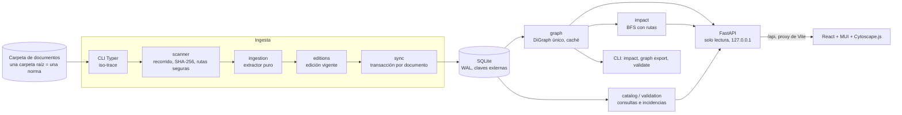

# ISO Trace — Arquitectura

ISO Trace es un monolito modular en Python con una interfaz web de una sola página. La **CLI** escribe la base de datos (ingesta); la **API** y la **interfaz web** solo la leen. SQLite es la única fuente de verdad; el grafo de NetworkX (uno solo, con todas las normas) se construye a partir de ella y se descarta cuando la base cambia.

## Capas

| Capa | Paquete | Responsabilidad | Depende de |
|---|---|---|---|
| Extracción | `backend/app/ingestion/` | `ruta → ExtractionResult`. Lee PDF/DOCX, identifica el código del documento, delimita REFERENCIAS y extrae los códigos con su evidencia. **No toca la base.** | PyMuPDF, python-docx |
| Servicios | `backend/app/services/` | Ingesta y sincronización, ediciones, grafo, impacto, validación, consultas, set de referencia | `db`, `models`, `ingestion` |
| Persistencia | `backend/app/db/`, `models/`, `migrations/` | Motor SQLite con pragmas, sesiones, migraciones Alembic, modelos ORM | SQLAlchemy, Alembic |
| API | `backend/app/api/`, `schemas/` | Rutas GET con respuestas Pydantic, errores uniformes, caché de grafos | FastAPI, servicios |
| CLI | `backend/app/cli.py` | Único punto de escritura: `db init`, `ingest`, `ingest-file`, `prune`, más consultas y exportaciones | Typer, servicios |
| Interfaz | `frontend/src/` | Consulta: búsqueda por norma, detalle, documento a modificar (lista y grafo completo resaltado), impacto, grafo por vecindad, calidad | React, TanStack Query, MUI, Cytoscape.js |

La configuración (`backend/app/config.py`) se lee de variables `ISO_*` o de `.env` con pydantic-settings; nada está fijado en el código.

## Ingesta

Una corrida (`iso-trace ingest`) sigue estos pasos:

1. **Recorrido** (`scanner.py`): solo `.pdf`, `.docx` y `.xlsx` dentro de `ISO_DOCUMENTS_DIR`. Rechaza rutas fuera de esa carpeta e ignora los archivos temporales (`~$…`) y ocultos. Las demás extensiones solo suman al contador `unsupported_skipped_count`. La primera carpeta de la ruta relativa es la **norma**; los archivos sueltos en la raíz se informan y no se procesan.
2. **Hash** SHA-256 por streaming. En modo `--incremental` se saltean los archivos cuya ruta y hash ya están registrados.
3. **Extracción** de todos los archivos a procesar, sin tocar la base. Ver el contrato en `.claude/skills/iso-trazabilidad/SKILL.md` y el algoritmo en el §6 del plan. Las planillas XLSX solo se identifican (`not_applicable`). Un error inesperado de un lector se registra con su traceback y deja ese archivo como `error`, sin frenar la corrida.
4. **Ediciones** (`editions.py`): si un mismo código aparece en varios archivos de una norma, se elige la edición vigente:
   - copias idénticas → `duplicate_copy`;
   - mayor versión, salvo que una versión menor tenga una fecha más reciente;
   - a igual versión, PDF antes que DOCX y DOCX antes que XLSX;
   - si versión y fecha se contradicen, ninguna se publica (`ambiguous_editions`).
5. **Publicación** (`sync.py`), en **una transacción por documento**:
   - upsert del documento;
   - diff de referencias: se borran las que salieron y se insertan o actualizan las nuevas, con sus ocurrencias; cada destino se resuelve con la regla del grafo único (`resolution.py`: misma norma, si no la única otra norma que lo tenga, si no pendiente/ambigua);
   - si el documento es nuevo o se reactiva, se recalcula la resolución de todas las referencias a su código (puede resolver pendientes, mover una cita a la copia de la propia norma o volverla ambigua);
   - cierre de las incidencias previas del documento;
   - incremento de `meta.graph_version`.

   Si algo falla, se revierte solo ese documento y la incidencia `sync_error` se guarda en una transacción aparte.
6. **Faltantes**: solo en una corrida sobre la raíz completa, los documentos cuyo archivo desapareció pasan a `is_active=false` (`file_missing`). Sus citas entrantes se re-resuelven: pasan a la copia de otra norma si es la única, o quedan pendientes.
7. **Log de la corrida** (`run_log.py`): cada paso anterior se registra en `ISO_LOG_DIR/ingest-NNNNN-fecha.log` (líneas `fecha nivel evento clave=valor`): inicio, escaneo, extracción y publicación de cada archivo con sus referencias y ocurrencias, referencias duplicadas, incidencias, errores con traceback, re-resoluciones, faltantes y un resumen con los totales de la corrida y del grafo. Los totales también quedan en `ingestion_runs` (`log_path` incluido). `iso-trace ingest -v` muestra los mismos eventos en consola.

Las referencias solo se reemplazan cuando el estado es `ok`, `no_references` o `not_applicable` y el código del documento está confirmado. En cualquier otro caso se actualiza el hash, el estado y las incidencias, pero se conservan las referencias anteriores (`references_stale` en la API).

Una sola corrida de escritura a la vez: una corrida en estado `running` bloquea las demás. Si quedó colgada más de 6 h, o con `--force-unlock`, se marca `interrupted` y se libera.

## Grafo e impacto

- `graph.build_graph(session, filters)` arma un único `nx.DiGraph` con todas las normas. El id de un nodo documento es `"norma/código"`; los códigos citados sin documento (o ambiguos) son nodos virtuales con el código como id y `resolved=False`. La arista `A → B` significa que **A cita a B** y lleva `cross_norma` si une normas distintas.
- `GraphCache` guarda el grafo en memoria del proceso de la API por filtros y lo invalida cuando cambia `meta.graph_version`. Así, una ingesta se ve en la API sin reiniciarla.
- **Impacto** (`impact.impacted_by`): BFS sobre los **predecesores** hasta la profundidad pedida. Usa la distancia mínima (1 = directo, > 1 = indirecto) y guarda un padre BFS por nodo para reconstruir la ruta. Tolera ciclos y nunca incluye la raíz. **Dependencias** (`dependencies_of`): el mismo recorrido sobre los sucesores.
- **Subgrafo** (`neighborhood`): vecindad por dirección (`in`, `out`, `both`) y profundidad, recortada a `ISO_GRAPH_MAX_NODES` priorizando los nodos más cercanos.
- **Grafo completo** (`/api/graph/full`): solo para la vista "Documento a modificar", que lo dibuja una vez (cada norma como nodo compuesto) y resalta el documento y lo que cita sin recalcular el layout. Acotado por `ISO_GRAPH_FULL_MAX_NODES`.
- Incidencias **derivadas** (`validation.py`): se calculan sobre el estado actual en cada consulta y no se guardan. Son ciclos, documentos aislados, citas ambiguas entre normas, citas a inactivos, títulos citados distintos del real o entre sí, y códigos no resueltos parecidos a uno existente.

## API e interfaz

- FastAPI con sesiones de solo lectura (cada request termina en `rollback`), CORS solo para `GET` desde `ISO_CORS_ORIGINS` y escucha en `127.0.0.1` por defecto. Al arrancar verifica que la base esté migrada a la última revisión. Referencia completa en [api.md](api.md).
- La interfaz consume `/api` a través del proxy de Vite.
  - **Tipos:** se generan desde el esquema OpenAPI con `npm run gen:api`, y `test_openapi_contract.py` falla si `frontend/openapi.json` quedó desactualizado.
  - **Estado:** cada vista guarda el suyo en la URL.
  - **Grafo:** las vistas con Cytoscape (vecindad y documento a modificar) se cargan bajo demanda, porque es la dependencia más pesada. El grafo completo se pide una vez por `graph_version`.

## Decisiones

| Decisión | Motivo |
|---|---|
| Extractor puro, sin base | Se prueba con fixtures sintéticos y se audita con `iso-trace extract --json` |
| SQLite como fuente de verdad y grafo efímero | Cientos o pocos miles de documentos: el grafo se reconstruye en milisegundos (benchmark: subgrafo p95 ≈ 17 ms con 500 documentos) |
| Un solo grafo, carpeta raíz = norma | Hay referencias cruzadas entre normas: el impacto debe seguirlas. El código sigue siendo único por norma; una cita a un código presente en varias otras normas no se adivina (`ambiguous_reference`) |
| Planillas XLSX como nodos | Se citan desde otros documentos, pero no tienen sección REFERENCIAS: se identifican por nombre y no se analiza su contenido |
| Log por corrida en archivo | Auditoría de cada ingesta (totales, duplicados, errores con traceback) sin depender de la consola; los totales también quedan en la base |
| Transacción por documento | Un archivo con problemas no deja la base a medias ni frena al resto |
| Ante la duda no se publica | Una falla de lectura o una sección mal delimitada nunca borra referencias vigentes |
| Incidencias almacenadas y derivadas | Las de la ingesta describen un archivo concreto; las derivadas dependen del estado de todo el grafo |
| API sin acceso a los archivos | Los documentos son confidenciales: solo se exponen metadatos y extractos de evidencia |
| Sin LLM ni inferencia probabilística | Requisito del MVP: resultados reproducibles y explicables |

## Pruebas

| Nivel | Carpeta | Qué cubre |
|---|---|---|
| Unitarias | `backend/tests/unit/` | Normalización, códigos, encabezados, identificación, lectores (incluido XLSX), extractor, ediciones, resolución entre normas, log, grafo e impacto |
| Integración | `backend/tests/integration/` | SQLite y migraciones, ingesta (normas, planillas, re-resolución), log de corrida, CLI, API, contrato OpenAPI, set de referencia |
| Extremo a extremo | `backend/tests/e2e/` | Documentos sintéticos → CLI → API, con reingesta incremental |
| Documentos reales | `backend/tests/real/` (`-m real_docs`) | Resultados esperados sobre `samples/` y precisión/recall contra el set de referencia |
| Rendimiento | `backend/tests/bench/` (`-m benchmark`) | 500 documentos sintéticos |
| Frontend | `frontend/src/**/*.test.ts(x)` | Vitest + Testing Library + MSW: páginas (incluida la de documento a modificar), cliente, mapeo a Cytoscape y resaltado |
