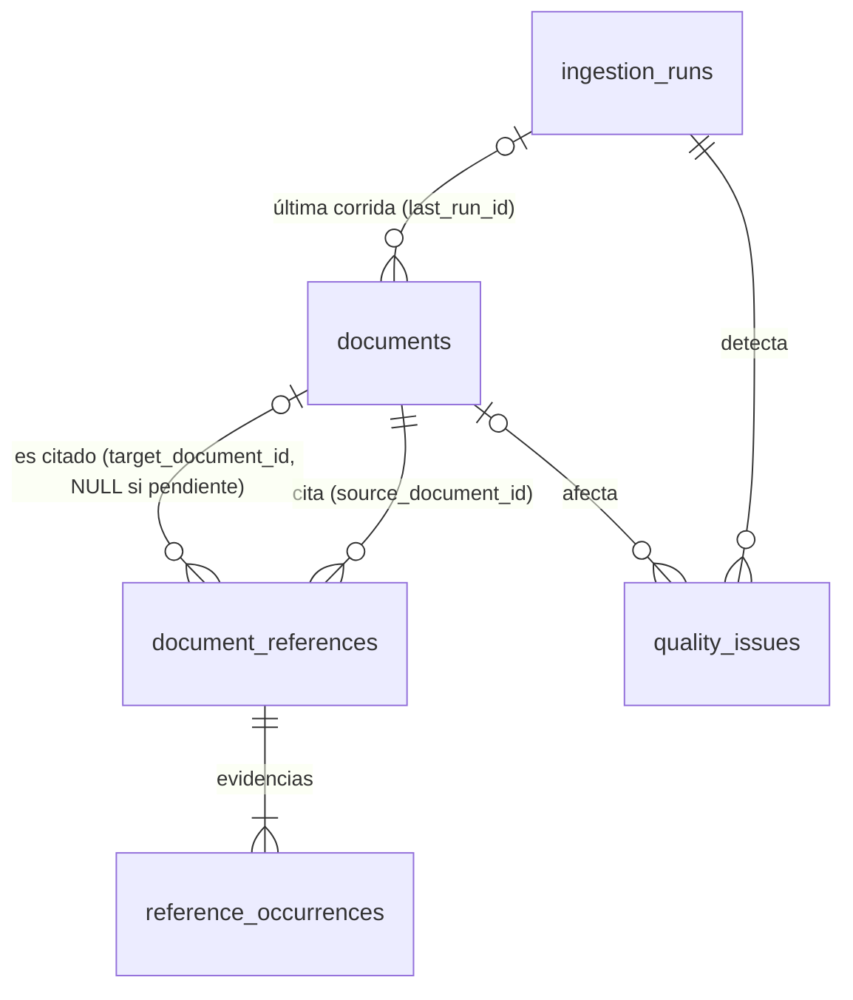

# ISO Trace — Modelo de datos

SQLite es la única fuente de verdad. Cada conexión activa `PRAGMA foreign_keys=ON`, `journal_mode=WAL`, `busy_timeout=5000` y `synchronous=NORMAL`. El esquema se crea y actualiza con Alembic (`backend/migrations/`, revisión actual `0004`) mediante `iso-trace db init`.

## Tablas

### `documents`

Un documento incorporado, único por norma. Todas las normas forman **un solo grafo**.

| Columna | Tipo | Notas |
|---|---|---|
| `id` | entero PK | |
| `norma` | texto, índice | Primera carpeta de la ruta relativa: la norma a la que pertenece |
| `code` | texto, índice | Código estable (`PO-SGS-400`). **`UNIQUE(norma, code)`**: el mismo código en dos normas son dos documentos distintos |
| `document_type` | texto, índice | Prefijo del código (`PO`, `PR`, `ES`…) |
| `system_code` | texto, índice | Segundo segmento (`SGS`, `SGSA`, `SGC`…) |
| `title` | texto NULL, índice | Título leído de la portada, de las propiedades o del nombre del archivo |
| `version` | texto NULL | Versión (`23`, `01`) |
| `file_path` | texto **UNIQUE** | Relativa a `ISO_DOCUMENTS_DIR`, con `/` |
| `folder` | texto | Carpeta del archivo relativa a la raíz (empieza por la norma) |
| `file_format` | `pdf` \| `docx` \| `xlsx` \| `xlsm` \| `xls` | CHECK |
| `file_size`, `file_mtime` | | Del archivo; la fecha decide entre ediciones |
| `sha256` | texto | Hash del último contenido leído |
| `references_sha256` | texto NULL | Hash del contenido que generó las referencias vigentes. Si difiere de `sha256`, las referencias están desactualizadas (`references_stale`) |
| `extraction_fingerprint` | texto NULL | Huella de las reglas con que se procesó el archivo (código del extractor + `ISO_EXTRACTION_CONFIG`). Si no coincide con la actual, `--incremental` lo vuelve a procesar. NULL en documentos anteriores a la migración 0005 |
| `extraction_status` | enum | Ver la tabla de estados más abajo |
| `code_source` | enum NULL | `filename`, `content`, `filename+content` u `override` |
| `is_active` | booleano | `false` si el archivo desapareció |
| `metadata_json` | JSON | Páginas, propiedades del archivo, sección encontrada |
| `last_run_id` | FK → `ingestion_runs` SET NULL | |
| `first_seen_at`, `last_processed_at`, `updated_at` | fecha UTC | |

### `document_references`

Relación lógica única **origen → código citado**: el origen cita al destino.

| Columna | Tipo | Notas |
|---|---|---|
| `id` | entero PK | |
| `source_document_id` | FK → `documents` CASCADE | Quien cita |
| `target_code` | texto, índice | Código citado, en mayúsculas (CHECK) |
| `target_document_id` | FK → `documents` SET NULL, índice | Documento citado según la regla de resolución (ver abajo). **NULL si no existe o si es ambiguo entre normas** |
| `group_name` | texto | Grupo predominante: `general`, `procedimientos` |
| `has_mixed_groups` | booleano | Las ocurrencias aparecen en más de un grupo |
| `occurrence_count` | entero ≥ 1 | Cantidad de ocurrencias |
| `target_title_hint` | texto NULL | Título con el que se cita (se compara con el título real) |
| `created_at`, `updated_at` | fecha UTC | |

`UNIQUE(source_document_id, target_code)`: un código citado dos veces produce **una** relación con dos ocurrencias, no dos aristas. El tipo del destino sale del prefijo del código y es independiente del grupo.

### `reference_occurrences`

Evidencia de cada aparición del código en la sección REFERENCIAS.

| Columna | Notas |
|---|---|
| `reference_id` | FK → `document_references` CASCADE |
| `group_name` | Grupo de esta aparición |
| `ordinal` | Orden dentro de la sección |
| `page_number` | PDF, desde 1 |
| `paragraph_index`, `table_index`, `row_index`, `cell_index` | DOCX y tablas, desde 0 |
| `raw_text` | Token tal como se leyó (`[ es‑sgc–001 ]`) |
| `evidence_excerpt` | Línea donde aparece |

### `ingestion_runs`

Una corrida de la CLI.

- **Cuándo:** `started_at`, `ended_at`, `mode` (`full`, `incremental`, `single`), `root_path`.
- **Estado:** `running`, `completed`, `completed_with_errors`, `failed` o `interrupted`.
- **Contadores:** `processed`, `skipped`, `error`, `warning`, `new`, `updated`, `missing`, `no_section`, `unsupported_skipped` y `root_files`.
- **Referencias:** `references_count` y `occurrences_count` (de los documentos publicados en la corrida), `duplicate_references_count` (relaciones citadas más de una vez en su sección) y `unresolved_count` (pendientes en todo el grafo al terminar).
- **Log:** `log_path`, el archivo con el detalle de la corrida (`ISO_LOG_DIR`).
- **Opciones:** `options_json`.

### `quality_issues`

Incidencias detectadas durante la ingesta. Columnas: `run_id`, `document_id` (SET NULL), `file_path`, `code`, `issue_type` (texto libre, para agregar tipos sin migrar), `severity`, `message`, `details_json`, `created_at` y `resolved_at`. Al reprocesar un documento se cierran sus incidencias abiertas anteriores. Índice: `(issue_type, resolved_at)`.

### `meta`

Pares clave/valor. `graph_version` se incrementa en cada cambio publicado y sirve para invalidar la caché de grafos de la API.

## Estados de extracción

| Estado | Significado | ¿Reemplaza las referencias? |
|---|---|---|
| `ok` | Sección REFERENCIAS encontrada y delimitada | Sí |
| `no_references` | Sección encontrada y vacía (la única forma de declarar "sin referencias") | Sí, por un conjunto vacío |
| `no_section` | El documento no tiene sección REFERENCIAS (listados, formularios) | No; se registra en silencio. Si antes tenía referencias, se conservan y se emite `section_lost` |
| `needs_review` | Sección ambigua o con fin incierto | No |
| `requires_ocr` | PDF escaneado | No |
| `error` | Archivo ilegible, corrupto o cifrado | No |
| `source_code_unresolved` | No se pudo confirmar el código del documento | No (el documento no se publica) |
| `not_applicable` | Planilla (XLSX, XLSM o XLS): se identifica y puede ser citada, pero no se analizan sus referencias | Sí, por un conjunto vacío (una planilla nunca cita) |

## Reglas que el esquema garantiza

- **Resolución en el grafo único:** `A` (norma N) cita el código C. Si C existe activo en N, apunta a ese documento; si no, y existe en **una sola** otra norma, apunta a ese (referencia entre normas); si existe en varias otras, queda `NULL` y la validación informa `ambiguous_reference`.
- **Pendientes que se resuelven solos:** la resolución se recalcula para todas las referencias a un código cada vez que un documento con ese código aparece, se reactiva, se da de baja, se reemplaza o se purga. Una segunda copia en otra norma puede volver ambigua una referencia antes resuelta, y la baja de la copia de la propia norma la hace pasar a la de otra norma.
- **Baja de un documento:** al borrarlo se borran sus referencias salientes y sus ocurrencias (CASCADE). Sus citas entrantes se re-resuelven (o quedan pendientes).
- **Restricciones:** los CHECK y UNIQUE impiden códigos en minúsculas, relaciones duplicadas y conteos o páginas no positivos.

## Migraciones

| Revisión | Cambio |
|---|---|
| `0001` | Esquema inicial; carga `graph_version=0` |
| `0002` | Grafos por carpeta: `graph_name` derivado de `file_path`, unicidad `(graph_name, code)`, `root_files_count` |
| `0003` | Grafo único: `graph_name` → `norma` (unicidad `(norma, code)`), `xlsx` y `not_applicable` en los CHECK, contadores de referencias y `log_path` en `ingestion_runs`; re-resuelve las referencias entre normas |
| `0004` | Planillas `xlsm` y `xls` en el CHECK de `file_format` |

Las migraciones usan `render_as_batch=True`, porque SQLite no soporta `ALTER` completo. Como el modo batch recrea las tablas, `migrations/env.py` desactiva `PRAGMA foreign_keys` durante la migración (si no, recrear `documents` dispararía el `ON DELETE CASCADE` y borraría las referencias) y al final verifica `PRAGMA foreign_key_check`. Se prueban con `upgrade head → downgrade base → upgrade head`, y la prueba comprueba que el ORM no difiere del esquema migrado.
